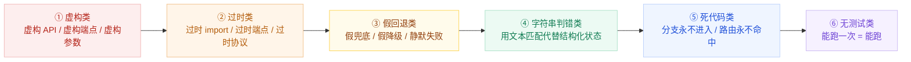
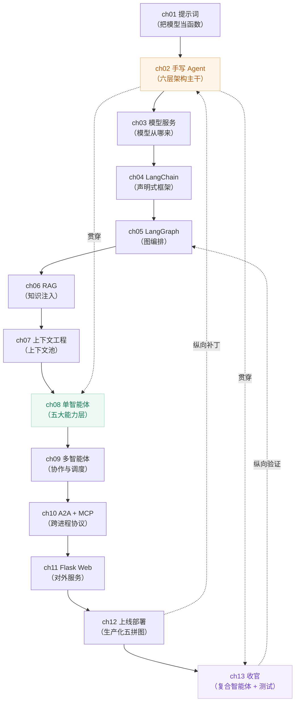

# 《AI Agent 开发：零基础构建复合智能体》——全书架构汇总（13 章）

> 本文档由 `chapter01 ~ chapter13` 各自的 `arch_汇总说明.md` 汇总而成，**只从架构视角**回答三个问题：
> 1. 这 13 章合起来，画的是一张什么样的图？
> 2. 每一章在这张图上占据哪个位置、补上了哪块拼图？
> 3. 跨越 13 章反复出现的不变式与"学费"，透露出什么工程规律？
>
> 配套架构图（同目录）：
> - `book-overview-architecture.svg` —— 全书 13 章分层总图
> - `book-evolution-map.svg` —— 13 章演进路线与能力栈叠加
> - `book-request-lifecycle.svg` —— 一次请求穿越大模型的完整生命线
> - `book-crosscutting.svg` —— 全书横切关注点与不变式

---

## 一、一句话结论

**这 13 章不是 13 个并列的知识点，而是同一套"Agent 工程"从内圈到外圈、从写出到跑稳的六个同心层。**

按书的写作顺序，13 章可以压缩成 **3 + 3 + 7**（三个阶段）：

| 阶段 | 章节 | 主题 | 一句话定位 |
|---|---|---|---|
| **上篇·写出一个 Agent** | ch01 → ch02 → ch03 | 提示词 · Agent 循环 · 模型服务 | 从"把大模型当函数用"，到"手写一个 Agent"，再到"模型从哪来、怎么扛住流量" |
| **中篇·把 Agent 装上框架与知识** | ch04 → ch05 → ch06 → ch07 | LangChain · LangGraph · RAG · 上下文工程 | 用声明换控制权、用图换分支、用检索换知识、用上下文池换记忆 |
| **下篇·把 Agent 做成系统** | ch08 → ch09 → ch10 → ch11 → ch12 → ch13 | 单智能体 · 多智能体 · A2A/MCP · Web 服务 · 上线部署 · 收官 | 单机能跑 → 多体协作 → 跨进程互联 → 对外服务 → 生产化 → 可验证 |

---

## 二、全书分层总图（对应 `book-overview-architecture.svg`）

把 13 章纵向叠起来，得到的是一张**六层 + 一横切**的工程栈。每一层都标注了"哪些章节在这一层贡献了什么"。

```
┌─────────────────────────────────────────────────────────────────────────┐
│ L6  交付与接入层      ch11 Flask Web / A2A 端点 · ch12 客户端与网关      │
│     对外承诺：HTTP 语义、鉴权、限流、流式返回                            │
├─────────────────────────────────────────────────────────────────────────┤
│ L5  编排与决策层      ch02 agent_chat 循环 · ch04 LangChain · ch05 图编排 │
│     ch08 单智能体五大能力 · ch09 多智能体协作 · ch10 编排组合            │
│     核心：决策权在模型，执行权在本地                                     │
├─────────────────────────────────────────────────────────────────────────┤
│ L4  上下文与记忆层    ch06 RAG 双链 · ch07 上下文池/路由/压缩/合并        │
│     ch08 记忆分层（短期/长期/情景/语义）  · ch12 记忆与知识组件           │
├─────────────────────────────────────────────────────────────────────────┤
│ L3  能力与工具层      ch02 工具注册表 · ch04 工具定义 · ch05 组件集成     │
│     ch06 检索零件 · ch10 MCP 工具暴露 · ch13 安全求值器                  │
│     核心：注册表消灭 if/elif；工具永不抛异常                             │
├─────────────────────────────────────────────────────────────────────────┤
│ L2  模型服务层        ch03 四层服务架构 / 一平台两扇门                    │
│     ch04 模型适配 · ch12 模型与协议组件 · char01 提示词即函数契约         │
├─────────────────────────────────────────────────────────────────────────┤
│ L1  基础设施与介质层  ch02 持久化 · ch07 持久化后端 · ch10 传输 · ch12 观测│
│     ch11 双 LLM 后端 · ch13 测试夹具                                     │
├─────────────────────────────────────────────────────────────────────────┤
│ ═══ 横切：可观测 / 安全对齐 / 成本预算 / 测试与验证（ch08·ch12·ch13）═══ │
└─────────────────────────────────────────────────────────────────────────┘
```

**读图要点**：越往上越接近"业务与交付"，越往下越接近"工程与基础设施"。而 ch12（上线部署）与 ch13（收官）是**纵向贯穿**的——它们不在任何单一层，而是给每一层都打上生产化与可验证的补丁。

---

## 三、13 章逐章定位表

| 章 | 层位 | 架构主产出 | 关键结构 | 本章"学费 / 死法" |
|---|---|---|---|---|
| **ch01** | L2/L6 之间·内圈 | 提示词即函数：输入契约 → 输出契约 | 6 个 `.py` 单函数示例 | 把提示词当"自然语言玄学"而非契约 |
| **ch02** | L3+L5 主干 | **手写 Agent 六层架构**：交互交付 / 编排决策 / 记忆状态 / 能力工具 / 模型服务 / 存储介质 | `agent_chat` 单循环 + 三条不变式 | 把"能跑一次"当成"能跑"（无记忆、无容错、无持久化） |
| **ch03** | L1+L2 | **模型服务四层架构**：对外协议 / 治理 / 交付模式 / 模型供给 | 一平台两扇门（原生 SDK ↔ OpenAI 兼容） | 端点过时、协议不一致、没有治理层 |
| **ch04** | L5 | **LangChain 四层分层架构**：任务编排 / Agent 能力组件 / 工具定义 / 模型适配 | 声明式链 + 六类"死法"谱系 | 用声明换走了控制权，却以为还能拿回来 |
| **ch05** | L5 | **LangGraph 四段演进线**：图编排 L1 → 组件集成 L2 → 业务流水线 L3 → 多 Agent 协作 L4 | 节点 + 边显式声明；并行扇出-汇聚 | 十连坑 + 四笔学费（状态污染 / 隐式依赖 / 无限循环 / 死代码） |
| **ch06** | L4 | **RAG 五段演进线**：检索零件 L1 → 预处理 L2 → 闭环 L3 → 显式 L4 → 异构融合 L5 | 双链管道（索引链 + 查询链） | 四笔学费（切片即真理 / 召回即正确 / 隐式 RAG 不可控 / 无评估） |
| **ch07** | L4 | **上下文工程四层**：表示 L1 / 路由 L2 / 存储 L3 / 合并 L4 ＋ 上下文池 | 四条不变式；池化复用 | 三笔学费（路由死代码 / timestamp 探针 / 缓存反而变慢） |
| **ch08** | L5 收敛 | **单智能体五大能力层**：预算 L5 / 记忆 L4 / 容错 L3 / 输入 L2 / 状态 L1 | 四条不变式；三笔学费（Memory 陷阱 / 死代码第三线 / 降级风格漂移） | 五大能力只做一半，等于没做 |
| **ch09** | L5 | **多智能体四层**：协作模式 L4 / 调度策略 L3 / 并发管理 L2 / 协议格式 L1 | 三种协作模式对照（流水线 / 辩论 / 主管） | 四笔学费（协作无边界 / 调度无策略 / 并发无隔离 / 协议无格式） |
| **ch10** | L5+L6 之间 | **A2A v1.0 六层架构**：编排组合 L6 / 通信模式 L5 / 核心能力 L4 / 业务对象 L3 / 协议信封 L2 / 传输 L1 | Task 七态生命周期 + 错误码表；A2A vs MCP | 六层各缺一层，跨进程就断链 |
| **ch11** | L6 | **Flask 服务完整架构**：4 个 HTTP 端点 + `/ask` 五步处理流程 | char10 → char11 映射表；双 LLM 后端 | 本地函数直接暴露成接口，中间层全丢 |
| **ch12** | 贯穿（生产化） | **七层组件栈 + 五块生产化拼图** | 客户端 / 接入防御 / Web / 编排 / 容错 / 记忆知识 / 模型协议 | 五条不变式；教材五笔学费（可观测/安全/吞吐/容错/互联各缺一） |
| **ch13** | 贯穿（收官验证） | **复合智能体分层总图 + 测试三部曲** | 入口层 / 主控层 / 能力层 / 协议层 / 模型层 / 测试层；六条不变式 | 教材七类通病（虚构 API / 过时 import / 假回退 / 字符串判错 / 死代码 / 静默失败 / 无测试） |

---

## 四、跨章不变式（全书级）

这 13 章里反复出现、且**每一章都必须遵守**的规律，汇总为 **8 条全书不变式**：

| # | 不变式 | 首次出现 | 反复复现 | 违反后果 |
|---|---|---|---|---|
| 1 | **决策权在模型，执行权在本地** | ch02 | ch04/05/08/09/10/13 | 要么模型瞎指挥，要么代码越权替模型判断 |
| 2 | **工具永不抛异常，错误是数据不是故障** | ch02 | ch08/10/11/12/13 | 单点工具报错打穿整条编排链 |
| 3 | **注册表驱动，消灭 if/elif 分支** | ch02 | ch03/04/10/13 | 加一个工具改十处代码，死代码分支 |
| 4 | **统一改写范式（原注释保留 → dashscope）** | ch01 | 全书 13 章 | 代码与教学意图脱节，无法对照 |
| 5 | **`result_format='message'` 必需** | ch01 | 全书 13 章 | 返回结构不一致，解析全线崩 |
| 6 | **显式优于隐式**（LangGraph 显式图 / 显式 RAG / 显式上下文路由） | ch05 | ch06/07/08 | 隐式行为不可观测、不可控、不可测 |
| 7 | **失败也是信息**（降级 / 兜底 / 重试 / 幂等） | ch08 | ch10/11/12 | 一次下游抖动 = 一次线上事故 |
| 8 | **可验证性优先**（测试先行 / 可执行夹具） | ch13（回填全书） | ch12/13 | "能跑一次"被误判为"能跑" |

---

## 五、教材"学费 / 死法"谱系

汇总各章提到的失败模式，全书可归纳为 **6 类通病**（顺序即排查优先级）：



> 这六类的共同根源只有一个：**把"看起来对"当成"验证过对"**。ch13 的测试三部曲（单元 / 契约 / 集成）就是针对这一根源的解药。

---

## 六、一次请求穿越全书（对应 `book-request-lifecycle.svg`）

把全书串成一条可执行的"生命线"，看一次用户请求如何穿越大模型的六层：

| 步骤 | 发生层 | 由哪章定义 | 动作 |
|---|---|---|---|
| 1 | L6 交付接入 | ch11 / ch12 | 用户 HTTP 请求 → Flask `/ask` 端点 → 鉴权限流 |
| 2 | L5 编排决策 | ch02 / ch04 / ch05 | 构造消息 → 进入 `agent_chat` 主循环 / 图节点调度 |
| 3 | L4 上下文记忆 | ch06 / ch07 / ch08 | 检索 RAG 双链 → 上下文池路由/压缩/合并 |
| 4 | L2 模型服务 | ch03 / ch01 | 走"原生 SDK 门"或"OpenAI 兼容门"调用模型 |
| 5 | L5 决策 | ch02 / ch08 | 模型返回 tool_call → 决策权交给模型 |
| 6 | L3 能力工具 | ch02 / ch10 / ch13 | 注册表查表执行工具 → MCP/A2A 跨进程调用 → 永不抛异常 |
| 7 | L1 基础设施 | ch02 / ch07 / ch12 | 写持久化 / 打 trace / 记成本预算 |
| 8 | L4 → L5 | ch07 / ch08 | 工具结果回灌上下文 → 回到主循环（ReAct） |
| 9 | L5 → L6 | ch09 / ch10 | 若为多智能体，Task 七态流转 → 结果汇聚 |
| 10 | L6 | ch11 / ch12 | 渲染返回 → 流式/非流式输出给用户 |

---

## 七、章节依赖与学习路径



**读图要点**：
- **实线**是主学习路径（严格递进：会写 → 会编排 → 会注入知识 → 会管理上下文 → 会做系统 → 会上线 → 会验证）。
- **虚线**是纵向贯穿关系：ch02 的六层架构主干在 ch08（收敛为五大能力层）与 ch13（收敛为复合智能体）被反复回访；ch12 与 ch13 是从生产化和可验证性两个方向对**全书每一层**打的补丁。

---

## 八、从"能跑一次"到"能跑"的四次跃迁

全书的真正主线，是**同一条 Agent 代码被四次重构**：

| 跃迁 | 章节 | 从 | 到 | 触发条件 |
|---|---|---|---|---|
| 第 1 次 | ch02 → ch03 | 单机直连模型 | 模型服务化（一平台两扇门） | 模型配额 / 多模型切换 / 团队共享 |
| 第 2 次 | ch04 → ch05 | 声明式链 | 显式图编排 | 需要分支 / 循环 / 并行 / 回退 |
| 第 3 次 | ch06 → ch07 | 检索增强 | 上下文工程（池化 + 路由） | 知识多了，上下文放不下、放不对 |
| 第 4 次 | ch10 → ch11 → ch12 | 单进程多体 | 跨进程服务 + 生产化 | 要对外、要扛量、要可观测、要容错 |

---

## 九、如何使用本汇总

| 你是… | 建议读法 |
|---|---|
| **初学者**（刚看完书） | 先看第八节"四次跃迁"建立主线，再看第三节逐章表补细节 |
| **要动手改代码** | 直接查第四节"8 条不变式"，把它当 code review checklist |
| **要排查线上问题** | 用第五节"六类通病"谱系做故障分类，用第六节"生命线"定位断点 |
| **要设计自己的 Agent** | 用第二节"六层总图"当骨架，逐层问"我这层由哪章补上" |

---

## 附：本汇总与已有文件的关系

| 文件 | 覆盖范围 | 与本文关系 |
|---|---|---|
| `arch/README.md` | 五模块划分判定 | 本文是"13 章 × 架构"视角，README 是"五模块"视角，互补 |
| `arch/agent的5大模块.md` | 五模块理论 | 同上 |
| `arch/llm-agent-architecture.svg` | 五模块静态架构图 | 本文的 `book-*` 系列是其**纵向展开**（从"一个 Agent 长什么样"到"13 章怎么长成这个样"） |
| `chapterNN/arch_汇总说明.md` | 单章架构 | 本文的**输入源**；单章看细节，本文看全貌 |
| `chapterNN/spec.md` | 单章规格 | 契约与验收视角，与架构视角正交 |

---

*生成时间：由 13 章 `arch_汇总说明.md` 汇总；配套架构图见同目录 `book-overview-architecture.svg`、`book-evolution-map.svg`、`book-request-lifecycle.svg`、`book-crosscutting.svg`。*
