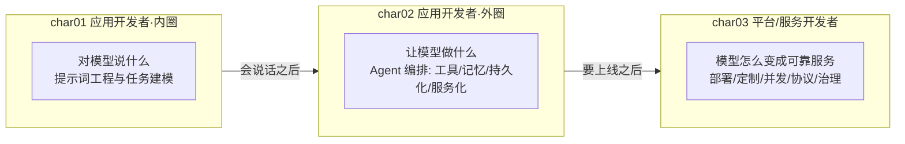
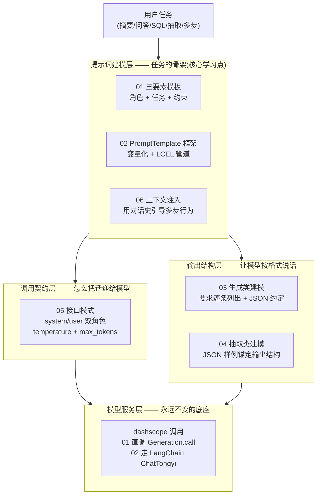
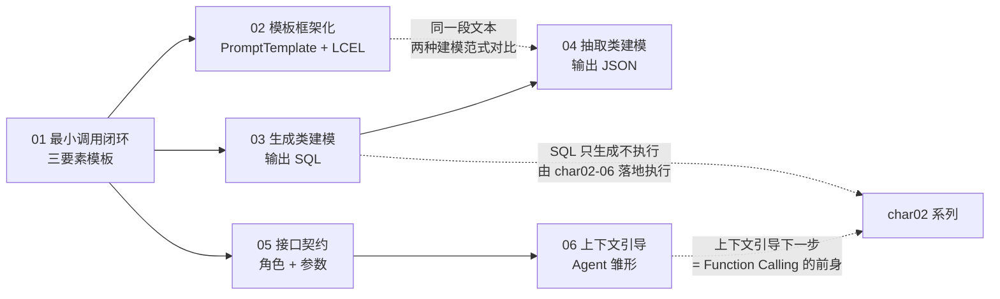
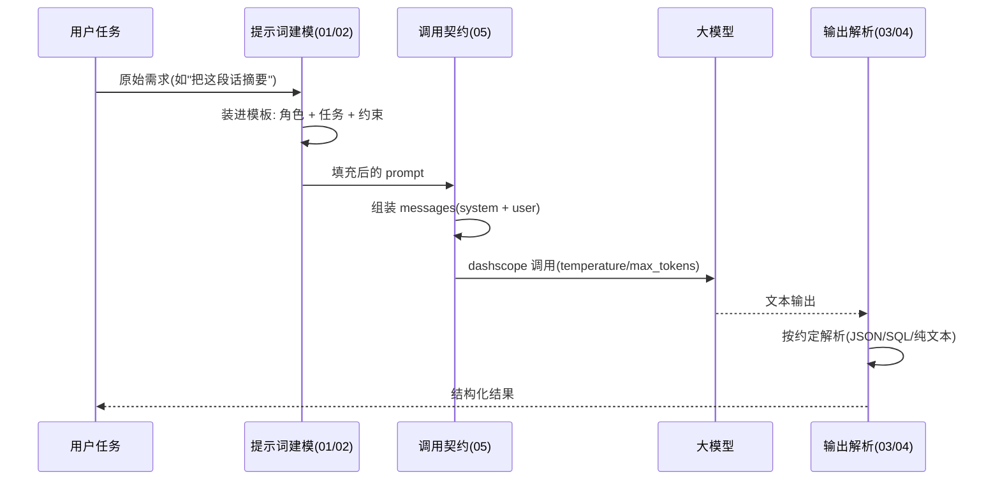
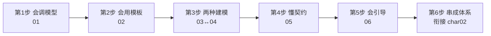

# char01 架构汇总说明 - 提示词开发技能总览

> 范围：`aiTest/char01` 全部 6 个 py 文件（01-06，均已改写为 dashscope 并运行验证）
> 配套：本目录另有一份 `index_汇总说明.html`（网页版），本文档为 Markdown + Mermaid 版，可在 VSCode / Typora / GitHub 中直接渲染
> SVG 独立架构图：见同目录 `svg/` 子文件夹（分层架构总图 / 六篇演进线全景图 / 单向生命线时序图 / 两种建模范式与三条不变式图）
> 生成日期：2026-10-10

---

## 一、char01 在三章课程中的架构定位

- char02 教"让模型动手"（Function Calling），char03 教"把模型变成服务"——而它们的**地基**都在 char01：**对模型说什么**。
- char01 的全部内容可以浓缩成一句话：**把大模型当函数用**——输入是提示词，输出是文本，中间没有任何框架魔法。六篇反复打磨的就是这个最小闭环。
- 学完 char01 你应该明白：**80% 的"模型调不动"问题，根源都在提示词建模，而不是代码**。

---

## 二、char01 分层架构总图（固定调用壳 + 三种任务建模）

**读图方法**：char01 的六篇 = **一个固定的"调用壳"（L3+L0，05 篇定契约、01/02 篇示范两种调用姿势）+ 三种"任务建模"变量**（L1 教怎么把任务装进提示词，L2 教怎么约束输出格式）。壳学一遍就够，之后所有工作只是换"建模变量"。

---

## 三、文件清单与速查表

| 文件 | 教学主题 | 一句话定位 | 验证状态 |
|---|---|---|---|
| 01_文本摘要_textSummarization.py | 最小调用闭环 | 提示词三要素（角色/任务/约束）+ 占位符模板 + dashscope 直调 | 已验证 |
| 02_提示词驱动的Agent.py | 模板框架化 | PromptTemplate 原样保留 + ChatTongyi + LCEL 管道（唯一用 LangChain 的篇） | 已验证 |
| 03_生成SQL语句的任务建模.py | 生成类任务 | 让模型"产出新内容"：要求逐条列出 + 只输出 SQL 不执行 | 已验证 |
| 04_文本抽取任务建模.py | 抽取类任务 | 让模型"从原文提取"：JSON 样例锚定输出结构 | 已验证 |
| 05_接口模式设计.py | 接口契约 | system/user 消息角色 + temperature/max_tokens 参数语义 | 已验证 |
| 06_通过上下文的行为引导LLM.py | 上下文引导 | 对话史注入引导多步任务——**Agent 的雏形** | 已验证 |

---

## 四、6 篇文件之间的依赖与递进关系

关键连线：
- **03 ↔ 04**：同一类调用壳下的**两种建模范式**——生成类（无中生有写 SQL）vs 抽取类（原文中提取字段）。这是 char01 最值得精读的对照实验。
- **01 → 02**：同一个任务从"手拼字符串"升级为"模板变量 + LCEL 管道"（`template | llm | StrOutputParser()`）——从脚本到工程。
- **05 → 06 → char02**：05 定下 system/user 契约，06 用上下文引导模型行为——当"引导"从手工拼上下文进化为协议化，就是 char02 的 Function Calling。**06 是两章之间的桥**。

---

## 五、一次提示词任务的完整生命线（全系列不变）

与 char02 的 sequenceDiagram 对比一眼就懂：**char01 的生命线是单向的**（一问一答就结束，没有工具循环、没有记忆回流）——这正是"把模型当函数用"的含义。char02 只是给这条单向线加了两个回路：工具执行回路和记忆持久化回路。

---

## 六、贯穿 6 篇的三条不变式

1. **system + user 双角色契约**：6 篇全部遵循"system 定角色与规则、user 装具体任务"的分工。这不是语法规定而是**接口契约**——把"你是谁"和"你干什么"分离，同一角色可以复用到千百个任务上。
2. **结构化输出全靠提示词约定，没有 Function Calling**：03/04 的 JSON、03 的 SQL，都是用"要求逐条列出 + 输出样例锚定"从提示词里"哄"出来的。这是纯提示词时代的技术——**它简单但不可靠**（模型偶尔不守约），char02-06 的 tools 协议就是对这个痛点的官方解法。先体会痛点，再学解法，教学顺序正是这么排的。
3. **原代码注释保留 + dashscope 统一调用**：6 篇原教材的调用代码全部注释保留，改写为 dashscope（01 直调 `Generation.call`，02 走 LangChain 的 `ChatTongyi`——证明**模板与管道代码可以原样保留，只换底层模型**）。原教材的 qwen-agent 虚构 API 已在真实环境中验证不存在。

---

## 七、两种建模范式对比 + 教学简化 vs 生产差距

**生成类 vs 抽取类**（char01 的方法论核心）：

| 维度 | 生成类（03） | 抽取类（04） |
|---|---|---|
| 任务本质 | 无中生有产出新内容 | 从原文中提取既有信息 |
| 提示词重心 | 要求逐条列出、边界约束（"只输出 SQL"） | 输出样例锚定、字段枚举 |
| 主要风险 | 幻觉（编造不存在的表/字段） | 漏抽、格式跑偏 |
| 温度建议 | 偏低（SQL 要严谨） | 极低（事实性任务） |
| 生产加固 | 表结构白名单 + 语法校验后执行 | Pydantic 解析校验 + 低置信重试 |

**教学简化 vs 生产差距**：

| 篇 | 教学版 | 生产版要补的第一课 |
|---|---|---|
| 01 | 手拼字符串模板 | 输出校验 + 重试（见 02 的框架化动机） |
| 02 | LCEL 管道单次调用 | 批量任务、流式输出、失败重试 |
| 03 | SQL 只打印不执行 | 白名单校验 + 只读账号 + 人工确认后才执行 |
| 04 | JSON 靠提示词约定 | Pydantic 严格解析 + 解析失败重试 |
| 05 | 固定 temperature 演示 | 按任务分级的参数策略与配置管理 |
| 06 | 手工拼上下文 | 会话管理、上下文窗口预算、char02 的 Function Calling |

---

## 八、新人学习路径（6 步，每步带自测标准）

1. **会调模型**（01）——自测：不看资料写出最小调用；说出提示词三要素各管什么。
2. **会用模板**（02）——自测：把 01 的手拼字符串改写成 PromptTemplate + LCEL 管道。
3. **两种建模**（03↔04）——自测：拿到一个新任务能判断该用生成类还是抽取类建模；说出两者的提示词重心差异。
4. **懂契约**（05）——自测：解释 system 和 user 的分工；temperature 调大调小分别适合什么任务。
5. **会引导**（06）——自测：演示怎么用对话史引导模型"下一步"做什么；说清它和 Function Calling 的差距。
6. **串成体系**——自测：向别人复述"char01 教对模型说什么、char02 教让模型做什么"的分界；指出 03 和 06 各自通向 char02 的哪一篇。

> 三章连读：**char01（提示词内圈）→ char02（Agent 外圈）→ char03（服务化基础设施）**。char01 学完，你就有了后两章所有复杂架构的那块最基础的地基——会跟模型说话。
