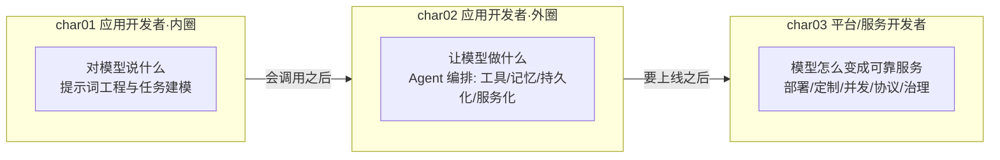
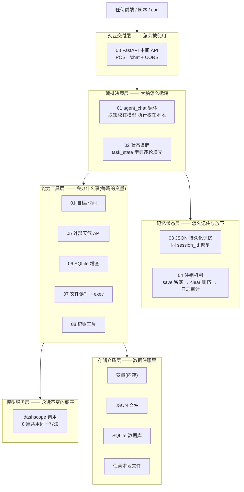
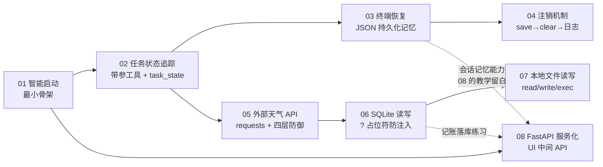
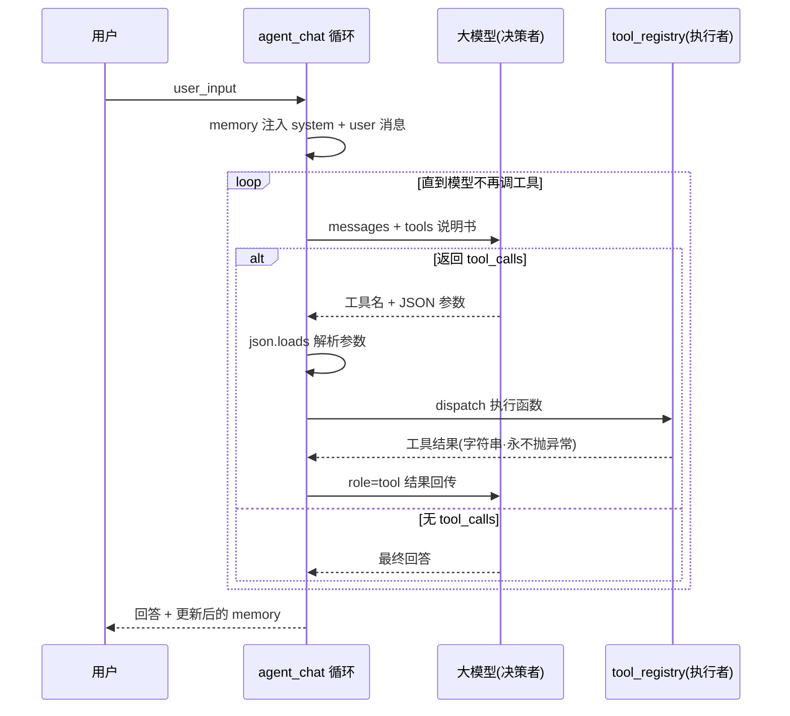
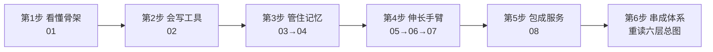

# char02 架构汇总说明 - Agent 开发技能总览

> 范围：`aiTest/char02` 全部 py 文件（01-08 共 8 篇教学文件 + agent_ui_api.py 副本，均已改写为 dashscope 并运行验证）
> 配套：每篇均有同名讲解 HTML；本目录另有一份 `index_汇总说明.html`（网页版），本文档为 Markdown + Mermaid 版，可在 VSCode / Typora / GitHub 中直接渲染
> SVG 独立架构图：见同目录 `svg/` 子文件夹（六层架构总图 / 八篇演进线全景图 / agent_chat生命线时序图 / 三条不变式与工具能力矩阵图）
> 生成日期：2026-10-10

---

## 一、char02 在三章课程中的架构定位

- **char01** 结束在"模型会说正确的话"（提示词建模）。
- **char02** 往外扩一层：**让模型动手**——工具调用、状态追踪、记忆持久化、资源注销、外部 API、数据库、文件操作、服务化交付。学完 char02，你拥有一个"能办事"的完整智能体。
- char03 再往外：把智能体背后的模型本身变成可运营的服务。

---

## 二、char02 六层架构总图（一个智能体的完整解剖）

**读图方法**：这六层是从 8 篇文件里"剥"出来的解剖结构。**01 篇就是 L4+L0 两层**（最小骨架），之后每篇往某一层添砖：02 添状态、03/04 添记忆、05/06/07 添工具、08 添交付。全部叠完，就是一个六层齐备的智能体。

---

## 三、文件清单与速查表

| 文件 | 教学主题 | 一句话定位 | 验证状态 |
|---|---|---|---|
| 01_智能启动过程展示.py | Agent 骨架 | 最小智能体：模型加载/工具注册/系统提示词/记忆注入/函数调用 | 已验证 |
| 02_自动追踪任务状态.py | 带参工具 + 状态 | task_state 字典跨轮填充（主题/时间/参会人） | 已验证 |
| 03_对话终端恢复功能.py | 持久化记忆 | PersistentJSONMemory + 同 session_id 中断恢复 | 已验证 |
| 04_具备注销机制.py | 资源注销 | save 留底 → clear 删 JSON → 写精简 txt 日志三步 | 已验证 |
| 05_查询外部天气API.py | 外部 API 工具 | wttr.in 真实 HTTP 调用 + 四层防御（校验/超时/状态码/异常） | 已验证 |
| 06_sqlLite数据库的读写操作.py | 数据库工具 | SQLite 增查 + ? 占位符防注入 | 已验证（数据真实入库） |
| 07_读写本地文件.py | 文件系统工具 | read_file / write_file / exec_code + exec 安全警示 | 已验证（写/读/执行三工具全通） |
| 08_基于FastAPI的UI中间API接口系统.py | 服务化交付 | UI ↔ 中间 API ↔ 智能体三段式 + CORS | 已验证（POST /chat 全链路） |

> 目录附注：`agent_ui_api.py` 是 08 篇的同内容副本——保留它是因为教材的启动命令写的是 `uvicorn agent_ui_api:app`，副本让该命令可直接照抄运行。

---

## 四、8 篇文件之间的依赖与递进关系

递进主线（一条"能力升级"的线）：
- **01 → 02**：工具从"零参"到"带参"，并引入跨轮状态。
- **02 → 03 → 04**：状态先落盘（恢复），再学注销（清理）——有了"记"，还要有"忘"。
- **02 → 05 → 06 → 07**：工具执行体三连跳——从调外部 HTTP，到写数据库，到操作文件系统，工具的"手臂"越伸越长。
- **01 → 08**：骨架最终被 FastAPI 包成 HTTP 服务，交付给任何前端。

---

## 五、全系列不变的骨架：一次 agent_chat 的完整生命线

这张图就是 char02 的灵魂：**8 篇文件 80% 的代码一模一样——都是这一个循环**。变化的只有两处：`tools` 说明书里加了什么工具、`tool_registry` 里挂了什么执行体。

> **最重要的架构洞察**：大模型应用开发 = **一套固定编排骨架 + 一批可插拔的工具执行体**。骨架学一遍就够，之后所有工作只是把业务能力封装成"永不抛异常、返回字符串"的工具函数。

---

## 六、贯穿 8 篇的三条不变式

1. **决策权在模型，执行权在本地**：模型只输出"想调什么工具 + 什么参数"（`tool_calls` 是 **dict 列表**，`call['function']['name']` 取名、`json.loads(call['function']['arguments'])` 取参），真正动手的是本地 `tool_registry.get(fn_name)`。模型是"动嘴的"，本地是"动手的"。
2. **工具函数的纪律——永不抛异常**：所有工具执行体都以字符串返回结果，出错也返回 `"失败：xxx"`。因为工具结果要作为 `role=tool` 消息回流给模型，抛异常会打断整个循环；把错误当数据喂回去，模型才知道"换个办法"。
3. **memory 是唯一的对话记忆**：8 篇都显式传递 `memory` 列表（`reply, memory = agent_chat(config, input, memory)`），框架不帮你记——**记什么、记多久、存哪里，全部显式可见**。02 的 task_state 是业务状态、memory 是对话记忆，两者分工不混用。

---

## 七、能力矩阵与生产差距

**工具能力矩阵**（8 篇的工具"手臂"从近到远）：

| 篇 | 工具 | 触达范围 | 生产版要补的第一课 |
|---|---|---|---|
| 01 | get_current_time / startup_check | 本机时间 | 并发会话隔离 |
| 02 | schedule_meeting | 内存字典 | 状态持久化（见 03） |
| 03 | log_user_input | JSON 文件 | 数据库（见 06）+ 并发写锁 |
| 04 | handle_task + shutdown | 进程资源 | 超时强杀、优雅停机信号 |
| 05 | get_weather | 外网 HTTP | 缓存、限流、重试、鉴权 |
| 06 | add/query_employee | SQLite | 连接池、迁移、权限最小化 |
| 07 | read/write/exec_code | 整个文件系统 | **白名单目录 + 沙箱**（exec 是最危险的工具） |
| 08 | add_record | 智能体自身 | 鉴权、限流、HTTPS、多 worker 部署 |

**诚实差距提醒**：教学版的 session_id（08）收了却没用——生产第一课是接上 03 的 PersistentJSONMemory 实现真正的多用户会话隔离；教学版无鉴权与限流——生产第一课是 API Key + 速率限制。

---

## 八、新人学习路径（6 步，每步带自测标准）

1. **看懂骨架**（01）——自测：不看资料手写 agent_chat 的 while True 循环；说清"决策权在模型、执行权在本地"。
2. **会写工具**（02）——自测：独立新增一个带参工具（说明书 + 执行体 + 注册表三件齐）。
3. **管住记忆**（03→04）——自测：说清 save/clear/log 各自的作用；解释"注销不是直接删"。
4. **伸长手臂**（05→06→07）——自测：给新工具套上四层防御；解释 ? 占位符为什么能防 SQL 注入；说出 exec 的风险与四条加固路。
5. **包成服务**（08）——自测：画出 UI↔中间 API↔智能体三段式图；解释为什么前端不能直调大模型；把 03 的持久化记忆接进 08（教学留白的答案）。
6. **串成体系**——自测：对照第二节六层总图，把 8 篇放回各自的楼层。

> 三章连读：**char01（提示词内圈）→ char02（Agent 外圈）→ char03（服务化基础设施）**。char02 学完你能"造一个会办事的智能体"；char03-06 会告诉你这个智能体的 Function Calling 协议源头在哪里。
