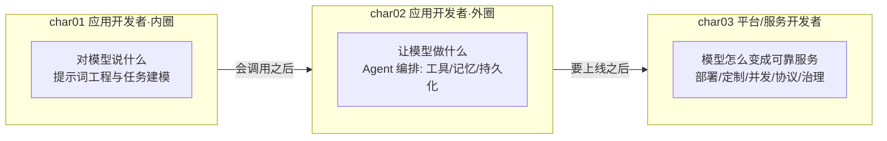
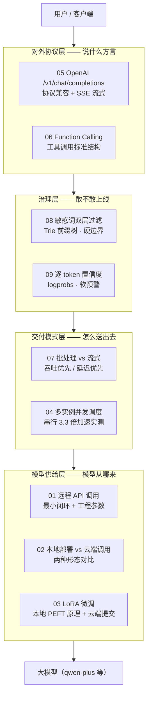
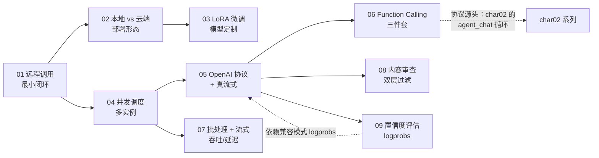
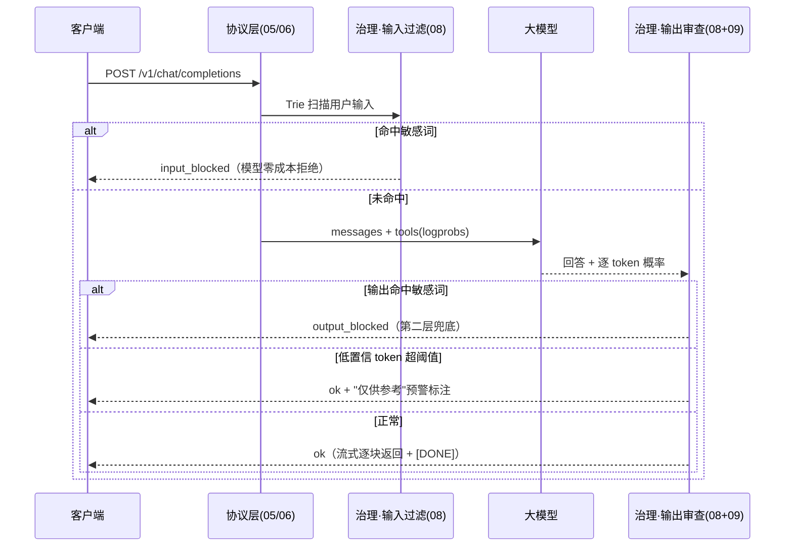
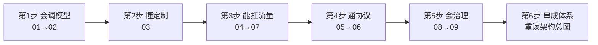

# char03 架构汇总说明 - 大模型服务开发技能总览

> 范围：`aiTest/char03` 全部 9 个 py 文件（01-09，均已改写为 dashscope 并运行验证）
> 配套：每篇均有同名讲解 HTML；本目录另有一份 `index_汇总说明.html`（网页版），本文档为 Markdown + Mermaid 版，可在 VSCode / Typora / GitHub 中直接渲染
> 生成日期：2026-10-10

---

## 一、char03 在三章课程中的架构定位

- **char01** 教"对模型说什么"——提示词内圈基本功。
- **char02** 教"让模型做什么"——Agent 外圈编排能力。
- **char03** 把前两章的假设（"模型已经在那里，去调就行"）拆开：**模型从哪来？怎么定制？怎么扛流量？对外说什么协议？内容安全谁把关？输出可信吗？**——这是从"用模型的人"升级为"运营模型服务的人"的技能树。

---

## 二、char03 四层架构总图（迷你模型服务公司）

**读图方法**：9 篇不是平铺列表，而是一个推理服务**自上而下的四个楼层**——先解决"模型从哪来"（供给层 L0），再解决"流量怎么扛、结果怎么送"（交付层 L1），再解决"对客户承诺什么接口"（协议层 L3），最后解决"安全与可信"（治理层 L2）。

---

## 三、9 篇文件速查表

| 文件 | 教学主题 | 一句话定位 | 验证状态 |
|---|---|---|---|
| 01_远程调用大模型语义助手.py | 远程调用 + 工程参数 | 把云端模型当函数用：temperature / max_tokens / 批量推理 / 错误兜底 | 已验证（5 成语全返） |
| 02_模拟Qwen本地调用.py | 本地部署 vs 云端调用 | 本地五步（加载→编码→生成→解码）换成云端一步 | 已验证（max_tokens 截断成教学点） |
| 03_模型的LoRA微调控制.py | LoRA 微调 | 本地 PEFT 九步原理 + 百炼 FineTunes 云端提交 | 已验证（提交遇平台权限 403，账号限制非代码问题） |
| 04_模拟支持多线程并发的GPU推理系统.py | 并发推理调度 | 多实例 + 线程分发：串行 vs 并发实测 3.3 倍加速 | 已验证 |
| 05_模拟ChatCompletion接口.py | OpenAI 协议兼容 | 实现 /v1/chat/completions：客户端换 base_url 无感迁移 | 已验证（非流式 + 真流式 44 块） |
| 06_支持Qwen模型函数调用标准结构.py | Function Calling | 真三件套：tools 说明书 + 模型自主决策 + 本地 dispatch | 已验证（调/不调三场景全通） |
| 07_并行处理与实时流式接口.py | 批处理 + 流式 | 吞吐（Batch）与延迟（Streaming）取舍：4.29s 并发批 / 0.43s 首字 | 已验证 |
| 08_审查敏感词过滤系统.py | 内容安全审查 | 双层防线（生成前/后）+ Trie 前缀树 | 已验证（含 output_blocked 触发） |
| 09_大模型的可信度评估.py | 幻觉与置信度 | 逐 token 概率 = 自我确信度；兼容模式 logprobs 实测 | 已验证（0.9365 vs 0.8763 对比） |

> 目录附注：`_temp_train.jsonl` 为 03 篇微调数据构建的演示产物（可删可留作格式参考）；`05/06/07_*.png` 为人工保存的运行截图。

---

## 四、9 篇文件之间的依赖与递进关系

关键连线：
- **04 → 07**：04 的多线程并发思想 + 05 的流式协议，在 07 收束成"批处理 + 流式"完整双模式。
- **05 → 06 → char02**：char02 八篇 Agent 的 `agent_chat` 循环，协议源头就是 06 的 Function Calling 三件套（注册表 + 说明书 + 循环）。
- **05 → 09**：dashscope 原生 SDK 不返回 logprobs，09 必须走 05 教过的 OpenAI 兼容模式——"协议是行业通用方言"的直接验证。

---

## 五、一次"带治理的对话请求"完整生命线

这张图把 05（协议）、06（工具）、07（流式）、08（双层过滤）、09（置信度）串进了一次真实请求——**治理不是独立模块，而是嵌在请求生命线上的两道关卡**。

---

## 六、贯穿 9 篇的三条不变式

1. **统一的钥匙与改写范式**：原教材全部依赖本地 GPU 或虚构 API；改写统一为"原代码注释保留 → 环境变量读 `DASHSCOPE_API_KEY` → 推理替换为 dashscope 云端"。**只动"模型怎么调"，从不动业务逻辑与架构**。
2. **build_prompt 的消失**：手动拼 `[用户]：/[助手]：` 的函数全部退场，messages 直接透传——云端 Chat 模型原生理解 role/content 结构。**接口越智能，客户端格式工程越少**。
3. **一平台两扇门**：

| 扇门 | 端点/SDK | 特点 | 使用篇目 |
|---|---|---|---|
| 原生 SDK | `dashscope.Generation.call` | 简单易用，能力子集（无 logprobs） | 01 / 02 / 03 / 04 / 06 |
| OpenAI 兼容模式 | `compatible-mode/v1/chat/completions` | 功能完整（logprobs / 工具协议 / 标准流式） | 05 / 06 / 09 |

> 经验法则：**遇到原生 SDK 缺能力，第一反应去兼容模式找。**

---

## 七、教学简化 vs 生产差距地图

| 篇 | 教学版 | 生产版要补的第一课 |
|---|---|---|
| 01 | 串行批量 + 简单 try/except | 并发批量（见 07）+ 重试/限流 |
| 02 | 云端替代本地（资源受限的务实选择） | 私有数据场景用本地/专有云部署 |
| 03 | API 提交微调任务（403 待开通） | 数据质量与标注、评估集、过拟合判断 |
| 04 | 线程池 + 槽位轮询 | asyncio、负载均衡、自动扩缩容 |
| 05 | 协议兼容但无鉴权/无 usage | API Key、用量统计、模型路由、错误 JSON 规范 |
| 06 | 单轮 Function Calling | while True 循环 + 会话记忆 + 工具异常隔离 |
| 07 | 线程池批处理（8 worker） | 失败隔离、批大小限制、协程化、断线处理 |
| 08 | 4 个词的 Trie 黑名单 | 语义分类模型 + 多模态审核 + 词库热更新 + 审计留痕 |
| 09 | logprobs 置信度汇总 | RAG 锚定、自洽性检验、裁判模型、引用溯源 |

---

## 八、新人学习路径（6 步，每步带自测标准）

1. **会调模型**（01→02）——自测：不看资料写出 01 的最小调用函数；说清本地/云端四维取舍。
2. **懂定制**（03）——自测：讲出"为什么 235B 本地跑不动而 LoRA 权重很小"。
3. **能扛流量**（04→07）——自测：画出串行 vs 并发时间线；说清"批处理优化机器效率、流式优化人的感受"。
4. **通协议**（05→06）——自测：手写 tools JSON Schema；解释"换 base_url 不换代码"。
5. **会治理**（08→09）——自测：用"暴 力带空格"实验说清双层过滤的必要性；说清低概率 token 为什么是幻觉预警而非判决。
6. **串成体系**——自测：对照第二节总图，向别人复述"迷你模型服务公司"的部门分工。

> 三章连读：**char01（提示词内圈）→ char02（Agent 外圈）→ char03（服务化基础设施）**，即"从调用模型到运营模型服务"的完整课程线。
