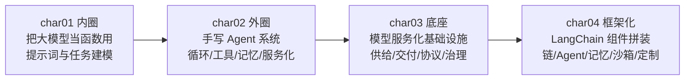
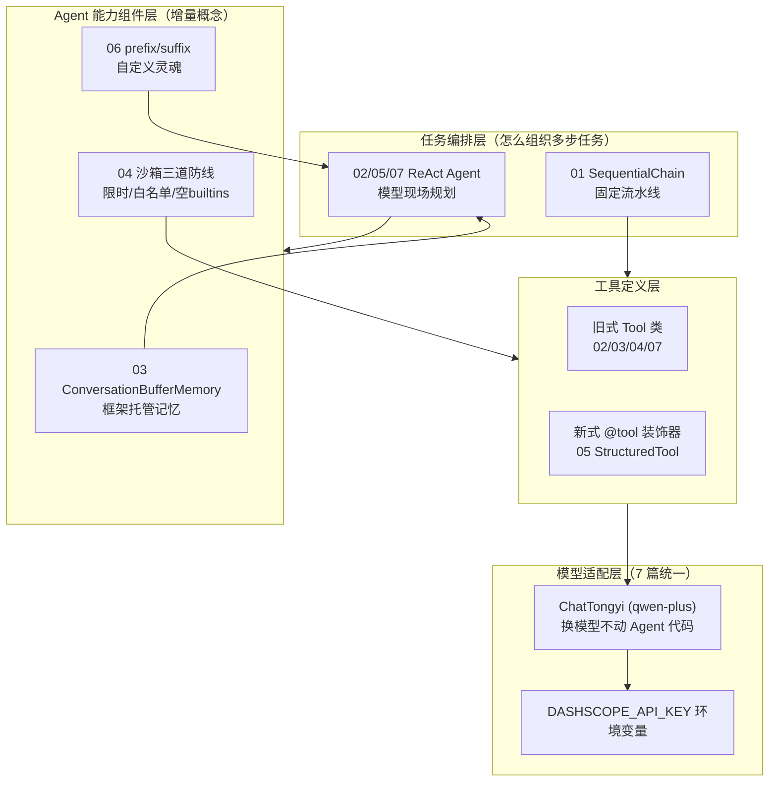
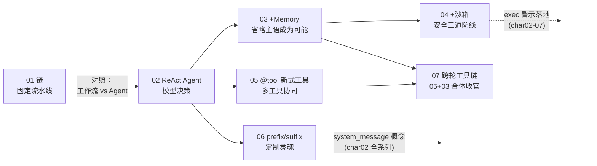
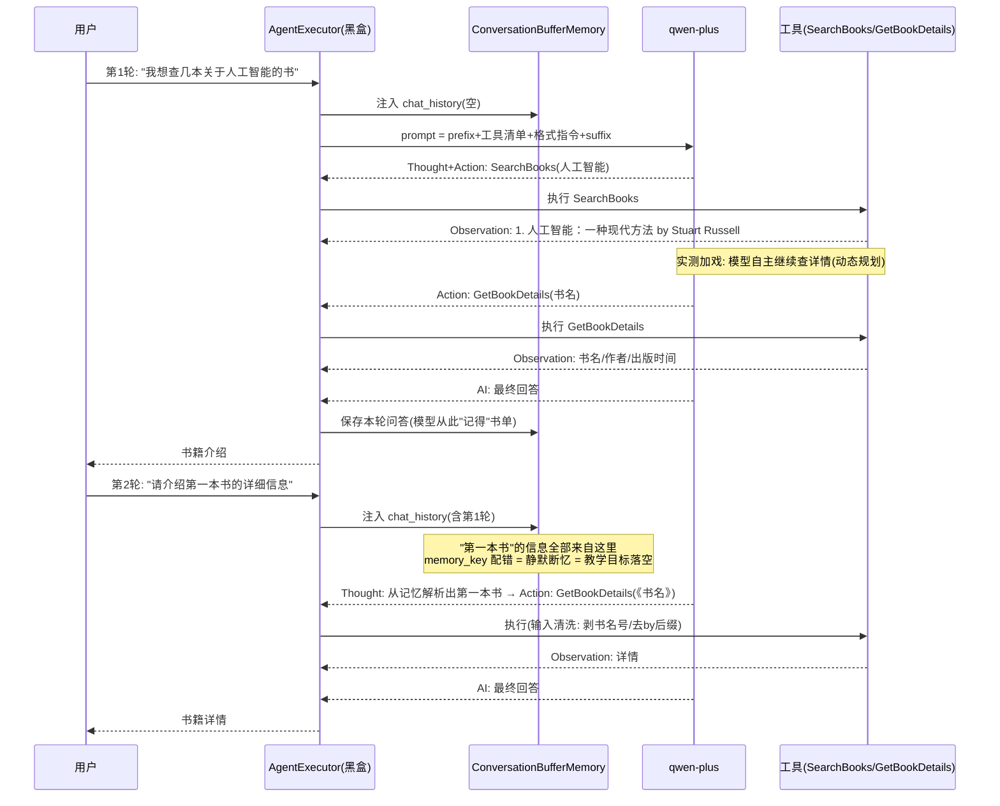
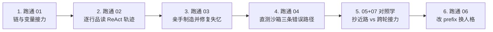

# char04 架构汇总说明 - LangChain 框架化开发技能总览

> 覆盖文件：`char04/01-07` 共 7 个 py 文件，全部已改写为 **dashscope（阿里百炼）+ LangChain 1.x** 并实际运行验证。
> 配套：逐篇讲解见同名 `01-07_*.html`；网页版汇总见 `index_汇总说明.html`。
> SVG 独立架构图：见同目录 `svg/` 子文件夹（分层架构总图 / 七篇技能演进线全景图 / ReAct跨轮生命线时序图 / 死法谱系与生产差距图）

---

## 一、char04 在四章体系中的定位

char04 想表达的核心命题：**用声明换控制权**——把 char02 手写的 agent_chat 循环、工具注册表、记忆管理全部交给 LangChain 组件。教学顺序刻意安排为"先手写看透原理（char02），再用框架享受效率（char04）"。

---

## 二、char04 分层架构总图

---

## 三、7 篇速查表（含验证状态与实测亮点）

| # | 文件 | 教学核心 | LangChain 组件 | 验证状态 |
|---|---|---|---|---|
| 01 | 01_langchain多段链式处理 | 链式拆解 + 变量自动接力 | SequentialChain + PromptTemplate | 三段接力全通；**教材自带 bug**：run() 多输出键必抛 ValueError |
| 02 | 02_tools与agent集成调度 | ReAct 循环与工具调度 | initialize_agent + Tool | ReAct 轨迹完整；**教材自带 bug**："20"*7.25 必抛 TypeError |
| 03 | 03_具备对话以及功能的agent | 框架托管记忆 | ConversationBufferMemory | 三轮递进全通（省略主语靠记忆补全） |
| 04 | 04_tool执行环境与沙箱控制 | 工具安全执行 | Tool + 受限 eval | 双路径通过；**平台硬伤**：SIGALRM 是 Unix 专属 → 线程限时；实测"双保险"拦截 |
| 05 | 05_多工具调用顺序管理 | 多工具协同 + 新式定义 | @tool 装饰器 | 双路径实测（1 工具抄近路 / 2 工具后理性跳过第 3 步） |
| 06 | 06_自定义提示词驱动agent | 提示词定制 | prefix/suffix | 三轮全通；**教材最深 bug**：custom_prompt 是概念代码（查源码实证） |
| 07 | 07_工具链动态规划逻辑 | 跨轮工具链 | Memory + 多工具 | 跨轮接力全通；**隐蔽 bug**：memory_key 静默断忆；openlibrary 超时打崩 Agent → 模拟书库 |

---

## 四、文件依赖与递进关系图

两条跨章关联（虚线）：**04 的沙箱**是 char02-07 exec 警示的落地实现 + char03-08 安全观的延续；**06 的 prefix/suffix** 是 char02 system_message 概念在 ReAct 模板中的入口迁移。

---

## 五、char04 的灵魂图：一次跨轮工具链的生命线

---

## 六、贯穿 7 篇的三条不变式

1. **一个骨架**：02/03/04/05/06/07 六篇共用 `llm + tools + memory + initialize_agent + run`——每篇只增量学一个新概念（记忆/沙箱/@tool/定制 prompt）。
2. **两种工具定义并存**：旧式 `Tool(name=, func=, description=)`（02/03/04/07，已废弃）vs 新式 `@tool` 装饰器（05，docstring 即说明书，1.x 推荐）——新旧对照是理解 LangChain 演化方向的钥匙。
3. **一个模型适配层**：7 篇统一 `ChatTongyi(qwen-plus) + DASHSCOPE_API_KEY 环境变量`——LangChain 的模型抽象兑现了"换模型不动 Agent 代码"（char03-05"协议即标准"的框架层体现）。

### 统一改写范式（与 char01-03 一致）

- 原代码注释保留 → import 换 langchain_classic / langchain_core → OpenAI 换 ChatTongyi → 运行验证 → 发现并修复教材自带 bug（bug 现场也注释保留）

---

## 七、教材代码质量谱系（char04 特色：六类"死法"全见过）

| 死法 | 篇目 | 现象 | 修复 |
|---|---|---|---|
| import 断裂 | 全部 7 篇 | ImportError | langchain_classic / langchain_core |
| 模型不可直连 | 全部 7 篇 | 认证失败/超时 | ChatTongyi + 环境变量 |
| API 误用（硬错误） | 01 | run() 多输出键 ValueError | 改 invoke() |
| 类型错配（硬错误） | 02 | "20"*7.25 TypeError | 显式 float() 转换 |
| 平台不兼容 | 04 | SIGALRM 在 Windows 抛 AttributeError | 线程限时 |
| 概念代码（最深） | 06 | custom_prompt 覆盖不生效（0.x 同样错，源码实证） | prefix/suffix 官方通道 |
| 静默失败（最隐蔽） | 07 | memory_key 不匹配 → 不报错但"失忆" | 改 "chat_history" |
| 无兜底网络调用 | 07 | 超时异常打崩 AgentExecutor | try/except + timeout + 模拟数据 |

> 03 与 05 无隐藏 bug，改写后即可运行。这张表的价值：**AI 应用代码的六类常见死法，每一种都有实测现场可回看**（详见各篇 HTML 第六节）。

---

## 八、教学版 vs 生产版差距

| 教学版特征 | 生产要求 |
|---|---|
| initialize_agent / ConversationBufferMemory（2.0 移除） | create_agent + LangGraph checkpointing / Store API |
| Buffer 记忆无上限、进程内、无会话隔离 | 摘要记忆/滑动窗口 + 持久化 + session_id 隔离 |
| 进程内线程级沙箱 | subprocess / Docker 容器隔离 + AST 白名单替代 eval |
| 外部依赖不可达即演示失败（维基百科/openlibrary 国内超时） | 可达数据源 + timeout + 降级策略 |
| 工具入参靠字符串猜测与清洗 | Function Calling JSON Schema 结构化参数 |
| 无输出审计 | 输入/输出双层过滤（char03-08）+ 置信度预警（char03-09） |

---

## 九、新人学习路径

每步自测标准：

1. 能画出三段链的变量流向图（01）
2. 能背诵 ReAct 四要素并说明谁产生谁消费（02）
3. 能解释 memory_key 与模板变量的匹配机制（03/07）
4. 能说出沙箱三道防线各挡什么、为什么"模型的拒绝"不能当安全防线（04）
5. 能完成工作流 vs Agent 的选型论证（02/05/07）
6. 能画出 ReAct 模板四段组装图并指出可定制区（06）

---

## 十、资源索引

| 资源 | 位置 |
|---|---|
| 逐篇讲解（9 章节固定格式） | 本目录 `01-07_*.html` |
| 网页版汇总 | `index_汇总说明.html` |
| 前三章汇总 | char01 / char02 / char03 目录下同名 index / arch 文件 |
