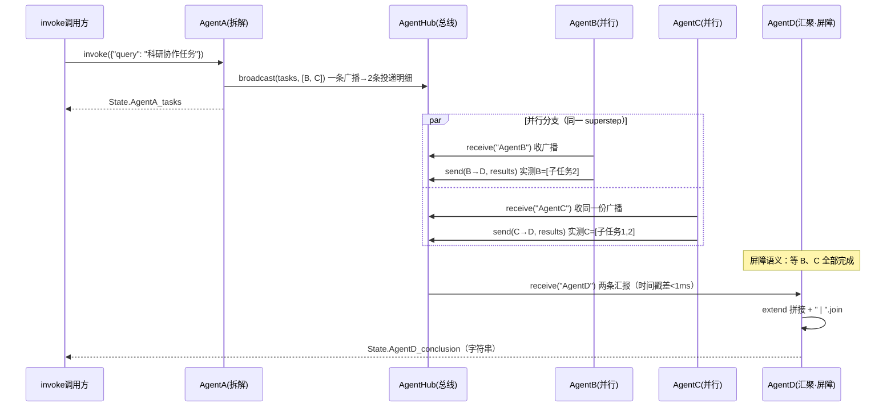

# char05 架构汇总说明 - LangGraph 图编排技能总览

> 配套文档：[index_汇总说明.html](index_汇总说明.html)（网页版总览） | 生成日期：2026-10-11
> 范围：char05 全部 10 个 py 文件（01-10，全部改写验证于 langgraph 1.2.11）

---

## 一、char05 在课程体系中的定位

**核心命题：用显式有向图编排大模型应用——执行流从"代码逻辑"搬到"图声明"。**

```mermaid
flowchart LR
    C1["char01<br/>手写顺序调用<br/>单向一问一答"] --> C2["char02<br/>手写循环<br/>agent_chat while True"]
    C2 --> C4["char04<br/>框架黑盒<br/>initialize_agent"]
    C4 --> C5["char05 本篇<br/>显式图 LangGraph<br/>节点+边全声明"]

    style C5 fill:#134e4a,stroke:#22d3ee,stroke-width:3px
    style C1 fill:#1e293b,stroke:#475569
    style C2 fill:#1e293b,stroke:#475569
    style C4 fill:#1e293b,stroke:#475569
```

四种编排形态的能力递进：char01 无循环无分支 → char02 有循环但硬编码 → char04 有循环有决策但不可见 → **char05 顺序/条件/并行/循环四种形状全部显式声明，既看得见又改得动**。

---

## 二、char05 分层架构总图

```mermaid
flowchart TB
    subgraph L4["多 Agent 协作层（08-10）"]
        M08["08 外部上下文存储<br/>State 与图外存储双通道"]
        M09["09 消息传递范式<br/>A→B→C 收发消息"]
        M10["10 广播 + 并行图<br/>扇出-汇聚"]
    end

    subgraph L3["业务流水线层（05-07）"]
        M05["05 四工位任务流<br/>值传递降级"]
        M06["06 科研助手五工位<br/>降级链断裂实证"]
        M07["07 数据库工位<br/>sqlite3 :memory:"]
    end

    subgraph L2["组件集成层（03-04）"]
        M03["03 链入图<br/>RetrievalQA + FAISS + 向量"]
        M04["04 工具入图<br/>@tool + .invoke"]
    end

    subgraph L1["图编排层（01-02）"]
        M01["01 节点+固定边<br/>最简顺序图"]
        M02["02 条件边<br/>路由函数+映射表"]
    end

    subgraph BASE["LangGraph 运行时"]
        ST["State（TypedDict schema）"]
        EXEC["superstep 执行引擎<br/>串行 / 并行 / 屏障"]
    end

    L1 --> L2 --> L3 --> L4
    L1 -.所有层共用.-> BASE

    style BASE fill:#0f172a,stroke:#22d3ee,stroke-width:2px
    style M10 fill:#134e4a,stroke:#34d399
```

四段演进线：**图的积木（01-02）→ 组件入图（03-04）→ 业务流水线与降级链（05-07）→ 通信与并行（08-10）**。

---

## 三、文件依赖与知识递进图

```mermaid
flowchart LR
    M01["01 顺序图<br/>State dict 静默失败"] --> M02["02 条件边<br/>路由三件套"]
    M02 --> M03["03 链入图<br/>RAG 真实跑通"]
    M02 --> M04["04 工具入图<br/>教材两处必炸"]
    M03 --> M05["05 四工位<br/>降级链·活"]
    M04 --> M05
    M05 --> M06["06 五工位<br/>降级链·断"]
    M06 --> M07["07 数据库工位<br/>降级链·幸运活"]
    M07 --> M08["08 假MCP辨析<br/>覆盖型存储"]
    M08 --> M09["09 假A2A辨析<br/>schema裁剪新坑"]
    M09 --> M10["10 广播+并行图<br/>教材输出造假顶点"]

    C04["char04<br/>initialize_agent 黑盒"] -.回应黑盒.-> M01
    C0203["char02-03<br/>PersistentJSONMemory"] -.外部记忆思想.-> M08
    C0206["char02-06<br/>? 占位符"] -.SQL防护.-> M07

    style M09 fill:#78350f,stroke:#fbbf24
    style M10 fill:#78350f,stroke:#fbbf24
    style M01 fill:#1e293b,stroke:#475569
```

两条跨章关联虚线：char05 整体是对 char04 黑盒的"显式化回应"；char02 的持久化记忆思想在 08 篇以图版重现。

---

## 四、char05 灵魂图：并行扇出-汇聚的执行时序（10 篇）

本图浓缩 char05 的三层思想：**图声明并行**（agentA 两条出边）、**消息总线解耦**（B/C 不共享变量，全靠收发）、**屏障汇聚**（agentD 自动等全部分支）。

---

## 五、贯穿十篇的三条不变式

| # | 不变式 | 内容 | 实证 |
|---|---|---|---|
| 1 | **节点 = 纯函数** | 入参整个 State（只读视角），返回增量字典（部分更新） | 十篇全部如此；01 篇实测"传整个状态" |
| 2 | **图结构 = 显式声明** | add_node + add_edge + set_entry_point；改流程=改声明，不动节点函数 | 05→06→07 三次换实现骨架零改动 |
| 3 | **State 生命周期 = 单次 invoke** | 跨执行/跨节点群共享必须外置 | 08 双 invoke 覆盖实证、09 累积实证 |

---

## 六、char05 独有的四笔"学费清单"（系列最珍贵部分）

### 1. 十连坑：State 静默失败谱系
- **01-08**：裸 dict 子类 → invoke 返回 None（错在出口，一眼见尸）
- **09 升级形态**：TypedDict 漏 query 字段 → 图正常跑完，输入键被**静默裁剪**（错在入口，结果"看起来正常"——更危险）
- **修复姿势**：TypedDict 字段 = 节点要读写的**全部键**（含入口键）

### 2. 降级链三部曲（05-07）
- 05 信号整体替换（活）→ 06 信号被格式加工（断）→ 07 信号未被 replace 命中（活，**纯靠运气**）
- 结论：失败状态是元信息，**生产用结构化 status 字段**，不靠字符串比对

### 3. 教材输出问题谱系（char05 是重灾区）
- 05 手写估错截断字数 → 07 首次全对 → 08/09 正确 → 10 **键名造假顶点**（AgentD_results 键不存在 + 展示随机分工最"好看"的一种可能）
- 方法论：**教材输出永远以实测为准，含随机性的示例尤其如此**

### 4. 协议名陷阱连续剧（08-09）
- 假 MCP（08）→ 假 A2A（09）：教材借热门名词做教学命名，真协议分别是 Anthropic（MCP）/ Google（A2A）的跨进程开放标准
- 见到"自定义 MCP/A2A 类"先做同名辨析；真实集成走 langchain-mcp-adapters

---

## 七、教学版 vs 生产版差距地图

| 教学简化 | 生产要求 | 相关篇 |
|---|---|---|
| fake_db / 模拟字典检索 | 向量库混合检索 + DB 全文索引 | 03/05/06/09 |
| :memory: 每次重建库 | 持久化库 + 连接池 + 只读权限 | 07 |
| 字符串失败信号 + 精确匹配 | 结构化 status 字段 + 类型化错误 | 05/06/07 |
| 模块级字典/列表当外部存储 | Redis/DB + 会话隔离 + TTL | 08/09/10 |
| random 随机分工 | 确定性调度 / 任务队列 / 幂等 | 10 |
| 同进程"假 MCP/A2A" | langchain-mcp-adapters / 真 A2A 栈 | 08/09 |
| inbox[-1] 取最新 | 消息确认 / 重试 / 幂等消费 | 09/10 |

---

## 八、给新人的学习路径

- **前置**：char01-04 学完（char04 的黑盒 Agent 是 char05 的直接动机）
- **后续衔接**：02 篇条件边 + 回边 = Agent 循环的图版本（char02 手写 while True 的图化）；向上通往生产级图编排（checkpoint 持久化 / human-in-the-loop / 子图）
