# char06 架构汇总说明 - RAG 检索增强生成技能总览

> 配套文档：[index_汇总说明.html](index_汇总说明.html)（网页版总览） | 生成日期：2026-10-12
> 范围：char06 全部 9 个 py 文件（01-09，全部改写验证于 DashScopeEmbeddings + FAISS）

---

## 一、char06 在课程体系中的定位

**核心命题：把 char01-05 的零件拼成 RAG——让大模型能"检索到什么就答什么"，而不是"只凭训练记忆瞎编"。**

```mermaid
flowchart LR
    C1["char01<br/>提示词基本功<br/>模型当函数用"] --> C3["char03<br/>模型服务化<br/>部署/并发/协议/治理"]
    C2["char02<br/>Agent 框架<br/>agent_chat 循环"] --> C4["char04<br/>LangChain 框架<br/>链/Agent/工具"]
    C4 --> C5["char05<br/>LangGraph 图编排<br/>节点+边"]
    C1 --> C6["char06 本篇<br/>RAG 检索增强生成<br/>向量化→索引→检索→融合→生成"]
    C2 --> C6
    C3 --> C6

    style C6 fill:#134e4a,stroke:#22d3ee,stroke-width:3px
    style C1 fill:#1e293b,stroke:#475569
    style C2 fill:#1e293b,stroke:#475569
    style C3 fill:#1e293b,stroke:#475569
    style C4 fill:#1e293b,stroke:#475569
    style C5 fill:#1e293b,stroke:#475569
```



RAG 的本质：**给 LLM 开一扇"查知识库"的门**，让它能"检索到什么就答什么"，而非凭空编。char06 是全书把这件事讲透的一章——从零件到系统、从单通道到双通道、从显式到隐式，九篇形成完整闭环。

---

## 二、char06 分层架构总图

```mermaid
flowchart TB
    subgraph L5["异构融合层（09）"]
        M09["09 双通道混合检索<br/>文本向量 + 结构化数据"]
    end

    subgraph L4["显式 RAG 层（07-08）"]
        M07["07 显式两步<br/>检索→拼 prompt→生成"]
        M08["08 Top-K 融合<br/>k=5 拼接多段"]
    end

    subgraph L3["闭环 RAG 层（05-06）"]
        M05["05 完整闭环<br/>Agent function calling"]
        M06["06 三种向量库<br/>FAISS/Chroma/Weaviate"]
    end

    subgraph L2["预处理流水线（04）"]
        M04["04 清洗+切片<br/>白名单正则 + 零宽断言"]
    end

    subgraph L1["检索零件层（01-03）"]
        M01["01 向量化+FAISS.from_documents<br/>LangChain 封装黑盒"]
        M02["02 现成切片器<br/>RecursiveCharacterTextSplitter"]
        M03["03 语义找回<br/>similarity_search k=2"]
    end

    subgraph BASE["基础底座"]
        EMB["DashScopeEmbeddings<br/>text-embedding-v3"]
        MODEL["qwen-plus<br/>Generation.call"]
    end

    L1 --> L2 --> L3 --> L4 --> L5
    L1 --> BASE
    L3 -.与 L4 对照.-> L4
    L5 -.双通道分别走.-> L1

    style BASE fill:#0f172a,stroke:#22d3ee,stroke-width:2px
    style M09 fill:#134e4a,stroke:#34d399
    style M06 fill:#134e4a,stroke:#fbbf24
```



五段演进线：**检索零件（01-03）→ 预处理流水线（04）→ 闭环 RAG（05-06）→ 显式 RAG 形态（07-08）→ 异构融合（09）**。

---

## 三、九篇速查表

| # | 篇 | 核心技能 | 验证状态 | 特殊标注 |
|---|---|---|---|---|
| 01 | 中文向量化存入FAISS | DashScopeEmbeddings + FAISS.from_documents | ✅ | LangChain 封装黑盒 |
| 02 | 文档切片实现 | RecursiveCharacterTextSplitter | ✅ | 默认分隔符对中文不友好 |
| 03 | 带语义找回的Agent | similarity_search k=2 | ✅ | 标题叫"Agent"但无 Agent |
| 04 | 文本清洗与句元切分 | 白名单正则 + 零宽断言断句 | ✅ | Colab ace_tools 本地无；re.split 末尾空串陷阱 |
| 05 | Qwen-Embedding 语义编码 | 原生 FAISS + 手动 build_prompt + Agent | ✅ | requests API 2025 年格式已变→DashScopeEmbeddings |
| 06 | 三种向量数据库 | FAISS(内存) / Chroma(嵌入式) / Weaviate(服务端) | ✅ FAISS+Chroma | Weaviate 需 Docker 注释保留 |
| 07 | RetrievalQA 问答系统 | 显式两步：检索→拼 prompt→生成 | ✅ | 显式 vs 隐式 RAG 对照教材 |
| 08 | 多段检索与Top-K融合 | top_k=5 融合拼接 | ✅ | 硬切 vs 贪婪拼接对照 |
| 09 | 文本与结构化混合检索 | 双通道（FAISS + pandas）+ 融合 | ✅ | 标题"DeepSeek"是假的，硬编码 if/elif |

---

## 四、文件依赖与知识递进图

```mermaid
flowchart LR
    M01["01 向量化+FAISS"] --> M03["03 语义找回"]
    M02["02 现成切片器"] --> M04["04 清洗+切片"]
    M04 --> M05["05 显式闭环<br/>build_prompt + Agent"]
    M05 --> M06["06 三种向量库<br/>原生 FAISS vs 封装"]
    M05 --> M07["07 显式 RAG 两步<br/>法律问答"]
    M07 --> M08["08 Top-K 融合<br/>k=5 拼接"]
    M08 --> M09["09 双通道融合<br/>FAISS + pandas"]
    M03 -.Agent function calling 原型.-> M05
    M01 -.LangChain 封装 = 原生 FAISS 的黑盒.-> M06

    style M05 fill:#134e4a,stroke:#22d3ee
    style M06 fill:#134e4a,stroke:#fbbf24
    style M09 fill:#134e4a,stroke:#34d399
```



---

## 五、三条不变式（新人最先要认出的模式）

### 不变式 1：统一改写范式

所有 9 篇的改写逻辑完全同构：

| 问题类型 | 教材写法 | 改写为 |
|---|---|---|
| 虚构框架 import | `from qwen_agent.agent import Agent` | `dashscope.Generation.call` + agent_chat 循环 |
| 原生 requests 嵌 API | `requests.post(EMBEDDING_API, json=...)` | `DashScopeEmbeddings`（LangChain 封装，接口稳定） |
| Tool 继承 | `class XxxTool(Tool): super().__init__(...)` | `class XxxTool:` 纯类 + 核心逻辑原样保留 |
| Colab 专属 | `import ace_tools; tools.display_...` | 原生 print |

嵌入模型签名固定为 `List[np.ndarray]`——**换模型只改 get_qwen_embedding 内部，FAISS 构建和检索零改动**（05/06 篇共同实证）。

### 不变式 2：显式 vs 隐式 RAG

```
显式 RAG（07/08/09）：                    隐式 RAG（05/06）：
  开发者写死"先检索、再拼 prompt、再调 LLM"  Agent function calling
  流程固定，必然走检索路径                  模型自主决策是否调工具
  新人一眼看懂 RAG 底层                    更优雅但藏了底层逻辑
```

**关键认识**：隐式 RAG 只是把显式 RAG 的三个步骤，交给模型在 Agent 循环里自主决策是否执行——底层逻辑完全同构。

### 不变式 3：RAG 的核心公式

```
RAG = 检索（Retrieval） + 生成（Generation）
检索 = 向量化 → 索引构建 → 相似度搜索（char06 01-03）
生成 = prompt 里放检索结果 → LLM 基于上下文回答（char06 07-09）
```

---

## 六、四笔学费（教材代码问题谱系）

### 学费 1：requests 嵌入 API 端点 2025 年格式已变（05 篇实测）

```python
# 教材写法（2023 年 OK，2025 年必炸）
EMBEDDING_API = "https://dashscope.aliyuncs.com/api/v1/services/embeddings/text-embedding/text-embedding"
resp = requests.post(EMBEDDING_API, ...)
data = resp.json()["output"]["embeddings"]  # KeyError: 'output'

# 实测返回：{"code": "BadRequest.IllegalInput", "message": "The input parameter requires json format"}
# 解法：DashScopeEmbeddings（LangChain 封装，内部走同一模型，接口稳定）
```

### 学费 2：LangChain 封装 = 原生 FAISS 的黑盒（01 vs 05）

```python
# 01 篇（LangChain 封装）：一行搞定
FAISS.from_documents(docs, DashScopeEmbeddings())

# 05 篇（原生 FAISS）：暴露黑盒内部
index = faiss.IndexFlatL2(dim)
index.add(np.vstack(embeddings))
D, I = index.search(qvec, k=5)

# 两者底层完全同构：调 emb_fn → 堆矩阵 → 灌入索引 → 搜索
# 理解了 05 篇，01 篇就不再是黑盒
```

### 学费 3：教材假标题/假功能

| 篇 | 教材标题 | 实际代码 |
|---|---|---|
| 03 | "带语义找回功能 Agent" | 无 Agent，只有 similarity_search |
| 08 | "DeepSeek" | 硬编码 if/elif，根本没调任何 LLM |
| 09 | 同上 | 同上 |

### 学费 4：re.split 末尾空串陷阱（04 篇）

```python
>>> re.split(r"(?<=[。！？])", "方案。")
['方案。', '']   # 末尾是分隔符 → 多一个空串！
# 解法：加过滤 [s for s in sentences if s]
```

---

## 七、RAG 三种形态对照表

| 形态 | 代表篇 | 检索 | 融合 | 生成 | 优点 | 缺点 |
|---|---|---|---|---|---|---|
| 隐式 RAG | 05/06 | Agent 自主调工具 | 模型看到 tool 结果自动整合 | function calling | 灵活、模型自主决策 | 藏底层、可能跳过检索 |
| 显式 RAG | 07 | 手动 call | join top-k | 手动拼 prompt | 流程固定、必然走检索 | 不灵活 |
| Top-K 融合 | 08 | 手动 call top-k=5 | join 多段成一个 context | 手动拼 prompt | 放宽召回、降低漏检 | 长 context 稀释注意力 |
| 双通道混合 | 09 | 两路并行（向量+结构化） | 两个 context 分别标注 | 手动拼 prompt | 兼顾文本和数据 | 硬编码 NL→SQL（生产要 LLM） |

---

## 八、生产视角

### 8.1 向量库选型

| 需求 | 推荐 | 理由 |
|---|---|---|
| 原型/实验/小知识库 | FAISS | 最轻量、纯内存、无服务依赖 |
| 轻量 RAG/个人项目 | Chroma | 嵌入式、自带持久化+元数据 |
| 生产分布式多租户 | Milvus / Qdrant / Weaviate | REST API、水平扩展、内置 rerank |

### 8.2 RAG 优化四道门槛

1. **rerank 重排序**：FAISS top-20 → CrossEncoder 精排选 top-3（生产标准做法）
2. **混合检索**：向量检索（语义）+ BM25（关键词）→ 融合（char06 09 篇的思路升级）
3. **索引持久化**：FAISS `faiss.write_index/read_index`；Chroma 默认持久化
4. **长上下文管理**：超出窗口时递归摘要 / MapReduce 压缩

### 8.3 NL→SQL 的升级路线

```
09 篇硬编码 if/elif → 生产用 LLM function calling：
  1. Agent 拿到用户问题
  2. 识别出数值查询意图
  3. 调 NL→SQL 工具（LLM 生成 SQL + pandas 执行）
  4. 返回结构化数据给 Agent 综合
```

---

## 九、6 步学习路径（附自测标准）

```mermaid
flowchart TD
    S1["Step 1: 理解"为什么 RAG""] --> S2["Step 2: 跑通 01 篇向量化+FAISS"]
    S2 --> S3["Step 3: 理解 04 篇清洗+切片的预处理流水线"]
    S3 --> S4["Step 4: 理解 07/08 篇显式 RAG 两步"]
    S4 --> S5["Step 5: 理解 05/06 篇隐式 RAG（function calling）"]
    S5 --> S6["Step 6: 理解 09 篇双通道异构融合"]

    style S2 fill:#0f172a,stroke:#22d3ee
    style S6 fill:#134e4a,stroke:#34d399
```



| Step | 学什么 | 自测标准 |
|---|---|---|
| 1 | RAG 的本质（给 LLM 开"查知识库"的门） | 能用自己的话解释"检索增强生成"这五个字 |
| 2 | 向量化 + FAISS 检索 | 能独立写出 01 篇的向量化+索引+检索三步 |
| 3 | 清洗+切片 | 能说出"白名单正则 + 零宽断言 + 贪婪拼接"各自的作用 |
| 4 | 显式 RAG 两步 | 能对比显式 vs 隐式 RAG 的三种差异；能解释"知识即上下文" |
| 5 | 隐式 RAG（function calling） | 能把显式三步改写成 Agent function calling 版本 |
| 6 | 双通道异构融合 | 能说出"文本向量+结构化数据"为什么需要两个通道 |

---

## 十、跨章知识衔接

```
char01 任务建模（03 生成SQL） ──→ char06 09 篇 NL→SQL 硬编码的生产解法
char02 Agent function calling ──→ char06 05/06 篇隐式 RAG 的核心机制
char03 嵌入模型 API 封装      ──→ char06 全部 9 篇 DashScopeEmbeddings 的稳定接口
char04 LangChain 组件         ──→ char06 01/02 篇 FAISS.from_documents / TextSplitter
char05 LangGraph 图编排       ──→ RAG 流水线可以声明为图（节点=检索/生成，边=条件判断）
```
