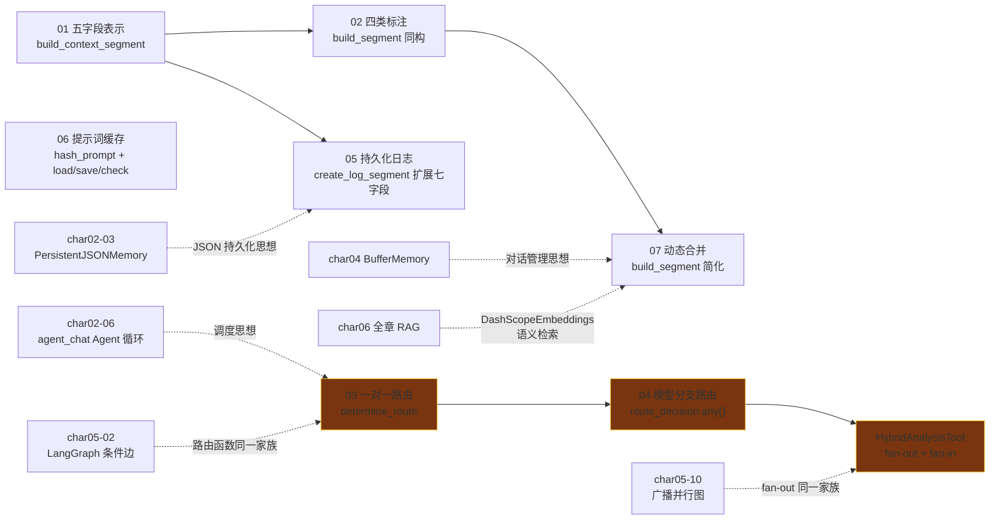
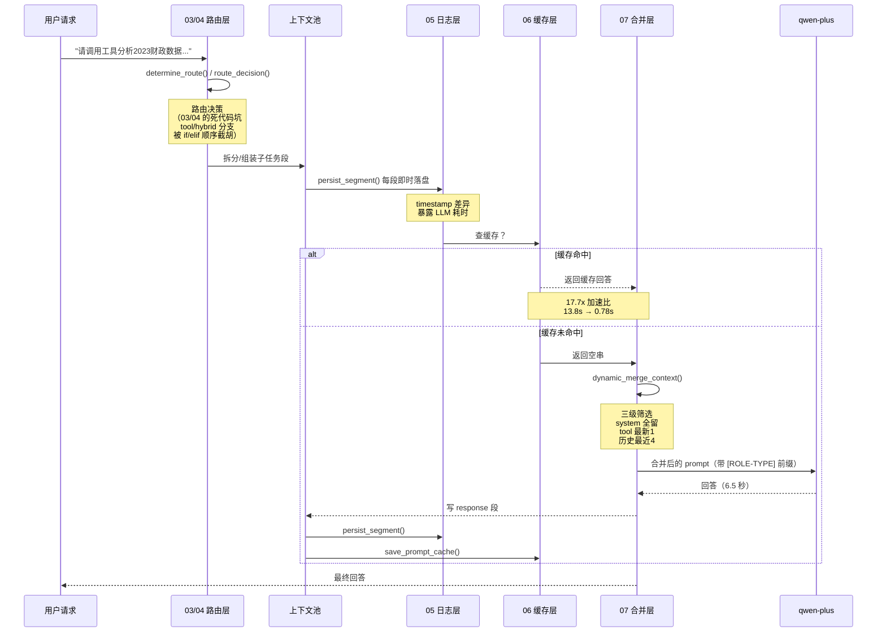

# char07 架构汇总说明 - 上下文工程与MCP协议技能总览

> 配套文档：[index_汇总说明.html](index_汇总说明.html)（网页版总览） | 生成日期：2026-10-12
> 范围：char07 全部 7 个 py 文件（01-07，全部改写验证于 dashscope qwen-plus）
> SVG 独立架构图：见同目录 `svg/` 子文件夹（五字段核心结构图 / 四阶段闭环全景图 / 分层架构总图 / 请求生命线时序图）

---

## 一、char07 在课程体系中的定位

**核心命题：上下文是 Agent 系统的数据血液——第一次把"上下文"本身当作独立工程对象来设计。**

char01-06 都在"用"上下文（messages 列表、State 字典、检索结果），但从未"设计"上下文。char07 是 **全系列第一次把上下文当作一等公民**——从数据结构定义、路由分发、持久化存储、到筛选合并，完整覆盖生命周期。向上承接 char05 调度层和 char06 检索层，向下通往 char08 MCP 真实协议。

---

## 二、char07 分层架构总图

```mermaid
flowchart TB
    subgraph L4["合并层（07 动态上下文合并）"]
        M07["三级筛选策略<br/>system 全留 → tool 最新1 → 历史最近4<br/>+ [ROLE-TYPE] 标注重排序"]
    end

    subgraph L3["持久化层（05/06）"]
        M05["05 审计日志<br/>JSONL 追加写<br/>七字段 id/timestamp/model<br/>每段即时落盘"]
        M06["06 提示词缓存<br/>JSON 覆盖写<br/>MD5 hash → 精确匹配<br/>13.8s → 0.78s 加速"]
    end

    subgraph L2["路由层（03/04）"]
        M03["03 一对一路由<br/>determine_route()<br/>if/elif 关键词匹配<br/>tool 分支死代码"]
        M04["04 一对多融合<br/>route_decision() any()<br/>HybridAnalysisTool fan-out<br/>hybrid 分支死代码"]
    end

    subgraph L1["表示层（01/02）"]
        M01["01 五字段表示<br/>{role,content,type,task_id,meta}<br/>内存上下文基础"]
        M02["02 四类标注组装<br/>system/memory/input/tool<br/>[TYPE] 前缀拼接"]
    end

    subgraph BASE["上下文池（跨层共享）"]
        POOL["context_pool<br/>List[Dict]<br/>所有层读写同一池"]
    end

    L1 --> POOL
    POOL --> L2
    POOL --> L3
    L2 --> POOL
    L3 --> POOL
    POOL --> L4

    style BASE fill:#0f172a,stroke:#22d3ee,stroke-width:2px
    style L4 fill:#134e4a,stroke:#34d399
```

四层围绕同一个上下文池运转：新段进池（L1）、请求进来时路由（L2）+ 落盘（L3）+ 查缓存（L3）、调 LLM 前从池子里挑（L4）。

---

## 三、文件依赖与知识递进图

三条跨章关联虚线：char02 的 JSON 持久化思想在 05 篇重现、char05 条件边/并行图与 03/04 路由是同一家族、char06 的 DashScopeEmbeddings 是 07 篇进阶语义精选的直接依赖。

---

## 四、char07 灵魂图：一次完整请求的全链路时序

本图浓缩 char07 的五层思想：
- **路由层**（R）：03/04 的路由决策，注出 if/elif 顺序截胡死代码
- **日志层**（L）：timestamp 差异天然暴露性能瓶颈
- **缓存层**（C）：命中直接回放省 99% LLM 开销
- **合并层**（M）：Token 预算管理，规则粗筛 → 可升级为语义精选
- **LLM 调用**：唯一的最慢环节（6.5 秒 vs 本地操作毫秒级）

---

## 五、贯穿七篇的四条不变式

| # | 不变式 | 内容 | 实证 |
|---|---|---|---|
| 1 | **路由函数 = 确定性决策** | 决策逻辑从业务代码抽离，纯函数输入输出 | 03 determine_route / 04 route_decision / char05-02 条件边路由函数同一家族 |
| 2 | **持久化目的决定存储格式** | 审计用追加写 JSONL（只增不减），缓存用覆盖写 JSON（整体替换） | 05 vs 06 存储格式差异，直接反映数据生命周期 |
| 3 | **字段设计跟着用途走** | 要按时间筛选就带 timestamp；要跨任务隔离就带 task_id | 01 五字段 → 05 七字段（+id/timestamp/model）→ 07 四字段（-task_id/meta +timestamp） |
| 4 | **标注前缀让 LLM 注意力更精准** | [TYPE] 或 [ROLE-TYPE] 显式标注信息性质 | 02 篇 [TYPE] 拼接、07 篇升级为 [ROLE-TYPE] 双信息标注 |

---

## 六、char07 独有的三笔学费清单

### 1. 路由死代码谱系（03-04）
- 03 篇 tool 分支：子任务拆分后丢失"调用"+"工具"关键词 → 永远不触发
- 04 篇 hybrid 分支：if/elif 顺序优先级被"政策"关键词截胡 → 永远不触发
- **结论**：组合类分支（hybrid/tool）必须最高优先级，因为其关键词组常常同时包含其他分支关键词

### 2. timestamp 是免费性能探针（05）
- 前三段毫秒级落盘，response 段晚 6.5 秒 = qwen-plus 真实耗时
- 生产系统的性能审计靠这种时间差定位瓶颈——日志本身就是探针

### 3. 缓存的加速比是线性可累积的（06）
- 精确匹配缓存：17.7x 加速（13.8s → 0.78s）
- 前提是 prompt 一字不差（MD5 精确匹配），同义改写永远不命中
- 语义缓存升级：embedding 相似度 > 0.95 即可命中，需要 char06 DashScopeEmbeddings

---

## 七、教学版 vs 生产版差距地图

| 教学简化 | 生产要求 | 相关篇 |
|---|---|---|
| 硬编码关键词路由 | LLM 意图分类 / 向量相似度 / 小样本微调分类器 | 03/04 |
| tool 输出硬编码字符串 | 真实工具 API + 超时重试 + 熔断 | 05/07 |
| 固定条数窗口截断（[:4]） | 按 Token 预算动态截断（tiktoken 计数） | 07 |
| 按条数截断（锯齿效应） | 按对话轮成对截断，避免孤儿段 | 07 |
| 无缓存淘汰策略 | LRU / LFU / TTL 过期 + Redis 分布式缓存 | 06 |
| JSONL 单文件持久化 | 数据库 + 索引 + 事务 + 并发安全 | 05 |
| 无敏感信息脱敏 | 用户隐私落盘前脱敏或加密 | 05 |
| tool_output 硬编码 | 真实工具调用结果也应纳入缓存层 | 06 |

---

## 八、给新人的学习路径

- **前置**：char01-06 学完（char06 DashScopeEmbeddings + FAISS 是 07 篇进阶依赖）
- **后续衔接**：char08（MCP 真实协议）——01/02 的数据结构和标注思想就是真实 MCP 的教学简化版本；向上通往生产级上下文工程（向量语义缓存 + LLM 摘要压缩 + 三层漏斗合并）
