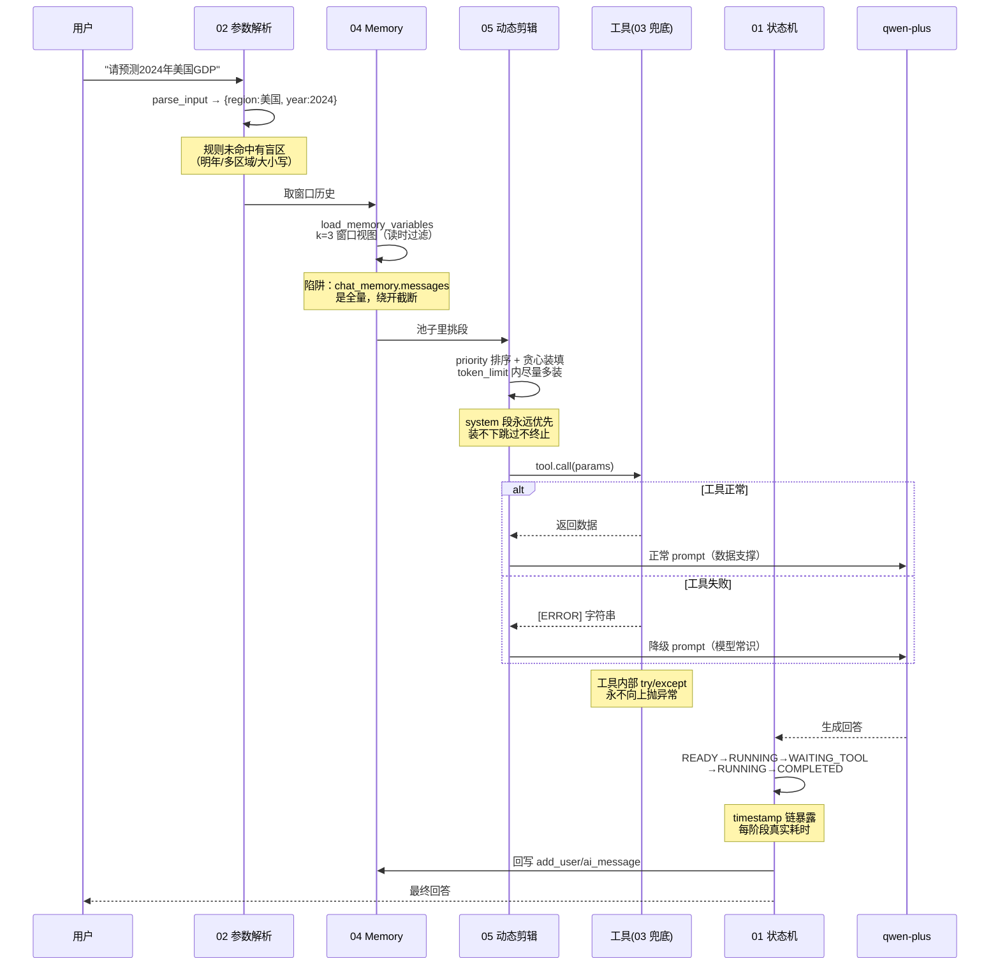

# char08 架构汇总说明 - 单智能体系统构建实战技能总览

> 配套文档：[index_汇总说明.html](index_汇总说明.html)（网页版总览） | 生成日期：2026-10-12
> 范围：char08 全部 5 个 py 文件（01-05，全部改写验证于 dashscope qwen-plus + LangChain 1.3.18）
> SVG 独立架构图：见同目录 `svg/` 子文件夹（定位图 / 能力全景图 / 请求生命线时序图）

---

## 一、char08 在课程体系中的定位

**核心命题：把 char01-07 学到的零件，组装成一个"能看、能听、能扛、能记、能省"的完整单 Agent。**

char07 是"数据层"（上下文的表示/存储/筛选），char08 是"控制层"（Agent 的生命周期/输入/故障/记忆/预算）——**前七章都在教零件，本章教组装**。五个 Agent 分别补上五种单点能力，合起来就是一个生产级单 Agent 的完整能力面。

---

## 二、char08 分层架构总图（五大能力层）

```mermaid
flowchart TB
    subgraph L5["预算层（05 动态剪辑）"]
        M05["贪心装填算法<br/>priority+timestamp+length<br/>token_limit 内尽量多装"]
    end

    subgraph L4["记忆层（04 Memory）"]
        M04["ConversationBufferWindowMemory k=3<br/>chat_memory 全量存<br/>load_memory_variables 窗口取"]
    end

    subgraph L3["容错层（03 异常处理）"]
        M03["工具自捕获异常<br/>[ERROR] 字符串信号<br/>失败 → 降级 prompt"]
    end

    subgraph L2["输入层（02 参数解析）"]
        M02["parse_input 三段式规则<br/>分词+后缀 / 关键词包含 / if-elif 优先级"]
    end

    subgraph L1["状态层（01 状态感知）"]
        M01["AgentState 六态枚举<br/>INITIALIZED→READY→RUNNING<br/>→WAITING_TOOL→COMPLETED/FAILED"]
    end

    subgraph BASE["LLM 调用基底"]
        LLM["dashscope.Generation.call<br/>qwen-plus"]
    end

    L1 --> L2 --> L3 --> L4 --> L5
    L3 -.降级直达.-> LLM
    L5 -.最终 prompt.-> LLM

    style BASE fill:#0f172a,stroke:#22d3ee,stroke-width:2px
    style M05 fill:#134e4a,stroke:#34d399
```

五层能力各自独立成篇，但共享同一个 LLM 调用基底——<strong>层与层之间是"能力叠加"而非"调用依赖"</strong>：任何一层都可以单独拿出来用在别的 Agent 上。

---

## 三、文件依赖与知识递进图

```mermaid
flowchart LR
    M01["01 状态感知<br/>AgentState 六态"] --> M03["03 异常处理<br/>+FAILED 兜底思想"]
    M02["02 参数解析<br/>parse_input"] --> M03
    M03 --> M04["04 Memory<br/>WindowMemory k=3"]
    M04 --> M05["05 动态剪辑<br/>贪心装填"]

    C701["char07-01/02<br/>上下文段五字段"] -.结构继承.-> M05
    C705["char07-05<br/>JSONL 日志 timestamp"] -.性能探针同家族.-> M01
    C707["char07-07<br/>动态合并规则窗口"] -.两流派互补.-> M05
    C403["char04-03<br/>BufferMemory"] -.手写版→框架版.-> M04
    C50X["char05 降级链<br/>结构化 status 结论"] -.对比教学.-> M03

    style M04 fill:#78350f,stroke:#fbbf24
    style M05 fill:#134e4a,stroke:#34d399
```

三条跨章关联虚线最有教学价值：05 篇的 build_segment 直接继承 char07 的上下文段思想；04 篇与 char04-03 是同一机制的手写版与框架版；05 篇与 char07-07 是上下文压缩的两个互补流派。

---

## 四、char08 灵魂图：一个完整请求的生命周期（五篇合一）

本图浓缩 char08 五篇的全部思想：<strong>听懂（02）→ 记住（04）→ 精打细算（05）→ 扛住故障（03）→ 全程可观测（01）</strong>。

---

## 五、贯穿五篇的四条不变式

| # | 不变式 | 内容 | 实证 |
|---|---|---|---|
| 1 | **失败也是信息** | 工具失败返回 [ERROR] 字符串而非抛异常，让上层可以做分支决策 | 03 篇降级路径 3 次实测命中 |
| 2 | **状态变更必须留痕** | 每次 update_state 都记录 timestamp + 状态值 | 01 篇时间戳链暴露工具 1s + LLM 13s 耗时 |
| 3 | **存储与视图分离** | chat_memory 全量存储 / load_memory_variables 窗口视图（读时过滤） | 04 篇 bug 修复前后对照：8 条 vs 6 条 |
| 4 | **字段设计跟着用途走** | 本篇 build_segment 砍 task_id/meta、加 timestamp/priority/length | 05 篇六字段 vs char07 五字段的演进 |

---

## 六、char08 独有的三笔学费清单

### 1. LangChain Memory 经典陷阱（04 篇，本章最重要发现）
- `chat_memory.messages` 是**全量累积视图**，直接访问 = k 参数失效
- 窗口截断只在 `load_memory_variables({})['history']` 发生（**读时过滤**设计）
- 修复后实测：Round 4 时原始存储 8 条 | 窗口视图 6 条（Round 1 被裁掉）
- 附带认知：ConversationBufferWindowMemory 已在 LangChain 0.3.1 废弃，新项目用 LangGraph checkpoint

### 2. 死代码谱系第三线（04 篇）
- FakeDataFetcher 初始化 + 注册给 Agent，但 ask() 从未调用——纯摆设
- 加上三个死 import（OpenAI/ConversationChain/messages_from_dict）
- 与 char07-03 tool 分支、char07-04 hybrid 分支构成三线并行的"注册了但没激活"谱系

### 3. 降级 prompt 的风格漂移 + LLM 质疑假数据（03 篇）
- 正常路径"语言简洁" vs 降级路径"简明解释"——实测降级回答更长更结构化，用户体验跳变
- 工具假数据 5.3% 被 qwen-plus 主动质疑（"显著高于历史趋势和主流机构预期"）
- 但**数据质量必须从源头保证，不能指望下游 LLM 兜底**

---

## 七、教学版 vs 生产版差距地图

| 教学简化 | 生产要求 | 相关篇 |
|---|---|---|
| 状态存内存 history 列表 | 持久化状态机（char07-05 JSONL / 数据库）+ 超时自动转 FAILED | 01 |
| 规则解析硬编码三条 | 声明式参数 schema + 两级漏斗（规则优先，LLM 兜底） | 02 |
| [ERROR] 字符串魔法值 | 结构化 status 字段（char05 结论）+ L1 重试 / L3 熔断 | 03 |
| Memory 类已废弃仍使用 | LangGraph checkpoint / Store API | 04 |
| len(content)//2 估 token | 真实 tokenizer（tiktoken）计数 | 05 |
| 五篇各自独立 | 合并为一个 StatefulSmartAgent 类（毕业设计） | 全部 |

---

## 八、给新人的学习路径

- **前置**：char01-07 学完（char07 上下文工程是 05 篇剪辑策略的直接基础）
- **后续衔接**：char09（多智能体协作）——单 Agent 五大能力齐备后，下一个问题自然是"多个 Agent 怎么分工协作"
