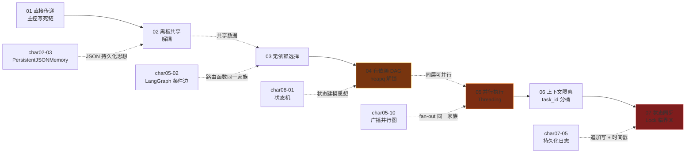

# char09 架构汇总说明 - 多智能体系统工程技能总览

> 配套文档：[index_汇总说明.html](index_汇总说明.html)（网页版总览） | 生成日期：2026-10-12
> 范围：char09 全部 7 个 py 文件（01-07 已改写验证 + 08 纯注释示例）
> SVG 独立架构图：见同目录 `svg/` 子文件夹（四层架构总图 / 七篇演进线全景图 / 并行与隔离联动时序图 / 三种协作模式对照图）

---

## 一、char09 在课程体系中的定位

**核心命题：从单 Agent 到多 Agent——第一次把"多个 Agent 怎么一起干活"当作独立工程对象来设计。**

```mermaid
flowchart LR
    C2["char02<br/>手写 Agent 循环<br/>messages 列表"] --> C9["char09 本篇<br/>多智能体系统<br/>协作/调度/并发/通信"]
    C4["char04<br/>LangChain 框架<br/>链/Agent/工具"] --> C9
    C5["char05<br/>LangGraph 图编排<br/>节点+边"] --> C9
    C7["char07<br/>上下文工程层<br/>表示/路由/存储/合并"] --> C9
    C8["char08<br/>能力组装层<br/>状态/降级/Memory"] --> C9

    style C9 fill:#134e4a,stroke:#22d3ee,stroke-width:3px
    style C2 fill:#1e293b,stroke:#475569
    style C4 fill:#1e293b,stroke:#475569
    style C5 fill:#1e293b,stroke:#475569
    style C7 fill:#1e293b,stroke:#475569
    style C8 fill:#1e293b,stroke:#475569
```



char01-08 都在"造一个 Agent"——给它加工具、加记忆、加状态、加降级。char09 是**全书第一次把多个 Agent 摆在一起**，问四个全新的工程问题：

1. **协作模式**：两个 Agent 之间的数据怎么传？（直接传递 / 黑板共享）
2. **调度策略**：有多个可选 Agent/任务时怎么选？（轮询/加权 / DAG 依赖解锁）
3. **并发管理**：多 Agent 同时跑时怎么防串台/写坏？（并行 + 隔离 + 同步）
4. **通信协议**：Agent 之间发消息，消息长什么样？（结构化元信息）

向上承接 char05 调度层、char07 上下文层、char08 能力层，向下通往生产级多 Agent 框架（AutoGen / CrewAI / LangGraph 多 Agent 图）。

---

## 二、char09 四层架构总图

```mermaid
flowchart TB
    subgraph L4["协作模式层（01-02）"]
        M01["01 直接传递<br/>主控写死调度链<br/>上游输出=下游输入"]
        M02["02 黑板共享<br/>SharedState 解耦<br/>写入/读取分工"]
    end

    subgraph L3["调度策略层（03-04）"]
        M03["03 无依赖选择<br/>轮询 counter%N<br/>加权重池构造"]
        M04["04 DAG 依赖+优先级<br/>heapq 优先级堆<br/>depends 解锁机制"]
    end

    subgraph L2["并发管理层（05-07）"]
        M05["05 并行执行<br/>Thread.start<br/>join 屏障等待"]
        M06["06 上下文隔离<br/>ContextScope task_id<br/>命名空间分桶"]
        M07["07 状态同步<br/>SharedLog Lock<br/>临界区互斥"]
    end

    subgraph L1["协议格式层（08）"]
        M08["08 通信元信息<br/>JSON 结构定义<br/>id/from/to/type/priority/payload"]
    end

    L4 --> L3
    L3 --> L2
    L2 --> L1

    style L4 fill:#134e4a,stroke:#22d3ee
    style L3 fill:#1e3a5f,stroke:#60a5fa
    style L2 fill:#3b1d1d,stroke:#f87171
    style L1 fill:#1e293b,stroke:#475569
    style M04 fill:#78350f,stroke:#fbbf24
```



四层自顶向下：**协作模式（怎么一起干活）→ 调度策略（怎么选谁先干）→ 并发管理（怎么同时干不坏）→ 协议格式（干的过程中怎么发消息）**。每层都是下一层的前提——先确定协作模式，再选调度策略，再用并发手段加速，最后定义消息格式。

---

## 三、七篇速查表

| # | 篇 | 核心技能 | 验证状态 | 特殊标注 |
|---|---|---|---|---|
| 01 | 3个Agent联动财经系统 | 主控写死调度链 + 直接传递 | ✅ | 幻觉放大链实测；假数据被 LLM 圆报告 |
| 02 | 多智能体状态共享 | SharedState 黑板架构解耦 | ✅ | 与 01 对照：解耦 vs 耦合；幻觉风险延续 |
| 03 | 任务分配轮训与权重 | TaskDispatcher 轮询/加权 | ✅ | 权重小样本不收敛（3 次 67% vs 理论 20%）；100 次才接近 |
| 04 | 任务依赖链与优先级 | TaskExecutor DAG + heapq | ✅ | 执行顺序 fetch→model→report→graph；依赖约束优先于优先级 |
| 05 | 子智能体并行执行 | ParallelExecutor Threading | ✅ | 并行 1.7s vs 串行 4.4s = 2.59x 加速比 |
| 06 | 上下文切换与隔离 | ContextScope task_id 命名空间 | ✅ | 三主题无串台；隔离检查代码段可复用 |
| 07 | 状态同步与锁控制 | SharedLog Lock 临界区 | ✅ | 写入顺序随机但永不交错；sleep 放锁内是教学演示 |
| 08 | Agent交互元信息 | JSON 通信格式注释示例 | —— | 无代码，纯设计参考；文件名拼写错误"agnet" |

---

## 四、文件依赖与知识递进图



三条跨章关联虚线：char02 的 JSON 持久化思想在 02 篇重现、char05 并行图与 05 篇 Threading 是同一家族、char07 的追加写日志与 07 篇 Lock 写入是同一家族。

---

## 五、三条不变式（新人最先要认出的模式）

### 不变式 1：统一改写范式

所有 7 篇的改写逻辑完全同构：

| 问题类型 | 教材写法 | 改写为 |
|---|---|---|
| 虚构框架 import | `from qwen_agent.agent import Agent` | `dashscope.Generation.call` |
| 虚构 Tool 继承 | `class XxxAgent(Tool): super().__init__(...)` | 纯类 + `self.name/description` 属性 |
| 虚构 Agent 实例化 | `agent = Agent(); agent.chat(messages=[msg])` | `dashscope.Generation.call(model="qwen-plus", messages=[...])` |
| 虚构 Message 类 | `Message(role="user", content=...)` | 普通 dict `{"role": "user", "content": ...}` |
| redis 替换 | —— | 无（7 篇均无 redis 调用） |

### 不变式 2：调度的本质 = 决策函数

无论哪种调度策略，底层都是一个"输入当前状态 → 输出下一个该干啥"的纯函数：

```
03 轮询：  counter % N → 选中 agent_i
03 加权：  random.choice([agent1, agent2, agent3, agent3, agent3]) → 重池等概率
04 DAG：   所有 depends 为空或已执行 → 入堆 → 堆顶优先级最大的先出
```

char05 的 LangGraph 条件边路由函数是这个家族的框架化升级版——理解了 03/04 的调度决策函数，再看 LangGraph 的 add_node/add_edge 就不再是黑盒。

### 不变式 3：并发安全三原则（优先级从高到低）

| 原则 | 代表 | 含义 |
|---|---|---|
| **能隔离就不共享** | 06 ContextScope | 每个任务一个独立命名空间，数据结构上就不可能串 |
| **能免锁工具就不手写锁** | queue.Queue（本篇未用） | Python 标准库的线程安全容器，内部已加锁 |
| **必须共享时才用 Lock** | 05/07 | 显式互斥，牺牲并发性换正确性 |

---

## 六、三种协作模式对照（01 vs 02 vs 07）

```mermaid
flowchart TD
    subgraph P1["模式一：直接传递（01）"]
        A1["Agent_1"] -->|"输出字符串<br/>作为输入传给"| A2["Agent_2"]
        A2 -->|"输出字符串<br/>作为输入传给"| A3["Agent_3"]
        C1["主控 run() 写死顺序"]
    end

    subgraph P2["模式二：黑板共享（02）"]
        B1["Agent_1"] -->|"写入"| BLK["SharedState<br/>黑板"]
        B2["Agent_2"] -->|"读取"| BLK
        B3["Agent_3"] -->|"读取"| BLK
        C2["黑板解耦"]
    end

    subgraph P3["模式三：并行+隔离+同步（05-07）"]
        subgraph PG["并行组"]
            T1["Thread_1<br/>独立 LLM"]
            T2["Thread_2<br/>独立 LLM"]
            T3["Thread_3<br/>独立 LLM"]
        end
        PG -->|"各自写"| SH["SharedLog + Lock"]
        PG -.各自读独立.-> CS["ContextScope<br/>task_id 分桶"]
        C3["并发安全三件套"]
    end

    style P1 fill:#1e293b,stroke:#64748b
    style P2 fill:#134e4a,stroke:#22d3ee
    style P3 fill:#3b1d1d,stroke:#f87171
```



| 维度 | 直接传递（01） | 黑板共享（02） | 并行+隔离+同步（05-07） |
|---|---|---|---|
| 耦合度 | 高（上下游紧耦合） | 低（写入者和读取者解耦） | 极低（各跑各的） |
| 数据流 | 单向链式传递 | 多写多读共享池 | 各线程独立 + 少量共享写 |
| 并发 | 串行 | 串行（本系列实现） | 真正并行 |
| 适用场景 | 固定流水线 | 共享上下文的多 Agent | 独立任务 + 需要汇总 |
| 风险 | 上游低质量 → 下游幻觉放大 | 黑板成瓶颈 | 并发安全（隔离+锁） |

---

## 七、实测发现的四笔学费

### 学费 1：幻觉放大链（01/02）

```
上游 Agent 只喂了硬编码事实（宏观三句 + GDP 5.3%）
→ 下游 qwen-plus 自行编造 PMI 51.2 / CPI 0.4% / "新三样" 出口 12.3%
→ 报告读起来极其可信但全是幻觉
→ 幻觉治理要在数据源头加校验（char08-02）+ LLM 整合 prompt 加约束
```

### 学费 2：权重是概率不是配额（03）

```python
# 权重 1:1:3 的 3 次实测：
# agent_3 → agent_1 → agent_1  → agent_1 占 67%，远高于理论 20%
# 跑 100 次才收敛到接近 20%/20%/60%
# 结论：小样本不能用来判断权重效果
```

### 学费 3：锁内做耗时操作是反模式（07）

```python
# 本篇为了教学把 sleep(0.5) 放进临界区
# 3 个线程 × 0.5s = 写入阶段至少 1.5s 串行等待
# 生产级做法：锁内只塞队列（微秒），锁外由专门线程消费
# → 生产者-消费者模式解耦互斥和慢操作
```

### 学费 4：文件名拼写错误（08）

08 篇文件名 `08_agnet之间交互元信息例子.py`——"agnet" 是 "agent" 的拼写错误。内容是纯注释 JSON 结构示例，没有可运行代码。

---

## 八、生产视角：多 Agent 框架 vs 本篇手写

| 生产框架 | 对应本篇概念 | 升级点 |
|---|---|---|
| AutoGen（微软） | 01 直接传递 + 08 通信协议 | 自动消息路由、人工介入、代码执行 |
| CrewAI | 02 黑板共享 + 03 调度策略 | Role 定义、Process 编排、Memory 持久化 |
| LangGraph 多 Agent | 04 DAG + 05 并行 | 声明式图拓扑、checkpoint、human-in-the-loop |
| MetaGPT | 01-07 全部 + 08 协议 | 软件公司角色扮演、SOP 流水线 |

**关键认识**：生产框架只是把本篇的手写模式（直接传递/黑板/调度/并发/协议）做成了声明式 API——理解了本篇的手写逻辑，再看任何多 Agent 框架都不会觉得是黑盒。

---

## 九、6 步学习路径（附自测标准）

```mermaid
flowchart TD
    S1["Step 1: 跑 01+02<br/>对比两种协作模式<br/>自测：说清直接传递 vs 黑板"] --> S2["Step 2: 跑 03+04<br/>理解调度的本质是决策函数<br/>自测：手写一个简单 DAG 调度器"]
    S2 --> S3["Step 3: 跑 05<br/>感受并行加速<br/>自测：实测串行 vs 并行耗时"]
    S3 --> S4["Step 4: 跑 06<br/>理解隔离为什么重要<br/>自测：去掉隔离看串台"]
    S4 --> S5["Step 5: 跑 07<br/>理解锁的语义与代价<br/>自测：去掉锁看打印交错"]
    S5 --> S6["Step 6: 综合<br/>把 05+06+07 组合成完整并发系统<br/>用 04 DAG 做调度"]

    style S1 fill:#134e4a,stroke:#22d3ee
    style S6 fill:#134e4a,stroke:#34d399
```



| Step | 学什么 | 自测标准 |
|---|---|---|
| 1 | 两种协作模式 | 能用自己的话解释"直接传递 vs 黑板共享"各自适合什么场景 |
| 2 | 调度的本质 | 能手写一个类似 04 的 DAG 调度器（heapq + depends） |
| 3 | 并行加速 | 能说清 threading vs multiprocessing 的选型原则 |
| 4 | 隔离的必要性 | 能说出"能隔离就不共享"这句话为什么成立 |
| 5 | 锁的语义 | 能在 10 秒内说出"临界区"和"互斥"的含义 |
| 6 | 综合 | 能把 05+06+07 组合成一个有 DAG 调度、并行执行、上下文隔离、状态同步的完整系统 |

---

## 十、跨章知识衔接

```
char02 Agent 循环（agent_chat） ──→ char09 01/02 多 Agent 协作
char04 LangChain 工具链         ──→ char09 各子 Agent 的 Tool 简化版
char05 LangGraph 条件边/并行图 ──→ char09 03/04 调度函数 + 05 并行
char07 上下文工程（context_pool）──→ char09 02 SharedState + 06 ContextScope
char08 状态机/降级/Memory       ──→ char09 04 DAG 状态 + 01/02 幻觉治理
```

char09 是 char01-08 的**综合应用题**——前八章造了各种零件（Agent、工具、记忆、状态、图、上下文、并发），char09 第一次把它们摆在一张桌子上，问"怎么一起干活"。
