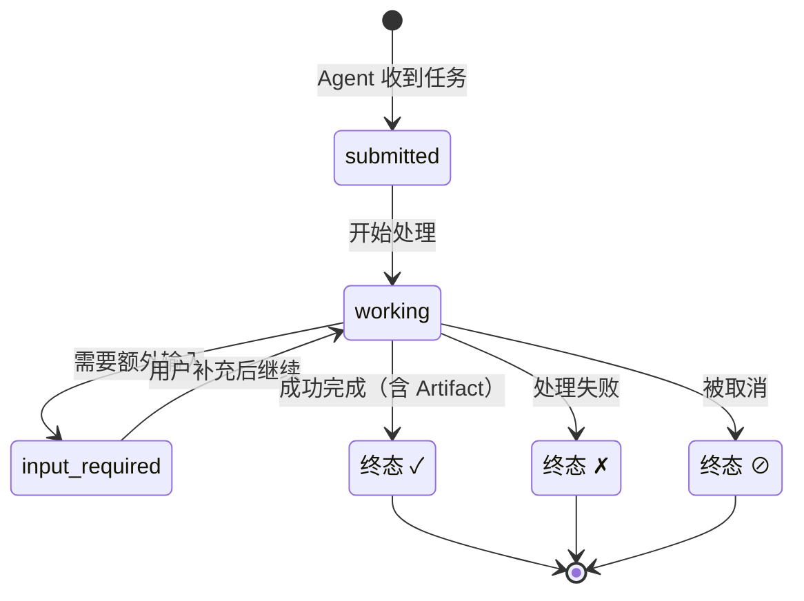

# char10 架构汇总说明 - A2A 协议与多 Agent 通信

> 配套文档：[index_汇总说明.html](index_汇总说明.html)（网页版总览） | 生成日期：2026-10-12
> 范围：char10 全部 6 个 py 文件（01-06 全部改写为 A2A v1.0 / MCP 规范实现）
> **SVG 独立架构图**：见同目录 `svg/` 子文件夹（A2A 协议组件总图 / 核心对象生命周期 / 认证+能力匹配时序图 / A2A vs MCP vs 教材简化对照图）

---

## 一、char10 在课程体系中的定位

**核心命题：从手写消息到完整协议——第一次用 Google/Linux Foundation A2A v1.0 规范重写多 Agent 通信层。**

```mermaid
flowchart LR
    C1["char01<br/>A2A 消息格式<br/>8 字段字典"] --> C10["char10 本篇<br/>A2A v1.0 协议完整实现<br/>6 篇递进：消息→认证→A2A+MCP→通信模式→Pub/Sub→协商竞标"]
    C2["char02<br/>Agent 身份认证<br/>token+signature"] --> C10
    C9["char09<br/>多 Agent 协作<br/>自定义通信元信息"] --> C10

    style C10 fill:#134e4a,stroke:#22d3ee,stroke-width:3px
    style C1 fill:#1e293b,stroke:#475569
    style C2 fill:#1e293b,stroke:#475569
    style C9 fill:#1e293b,stroke:#475569
```



char01-09 都在"造轮子"——手写 A2AMessage、自定义 AgentRegistry、for 循环调度。char10 是**全书第一次直面真实协议规范**：Google 2025 年发布的 A2A v1.0 协议（Agent-to-Agent Protocol），以及配套的 MCP（Model Context Protocol，Agent-to-Tool）。6 篇改写围绕一个主题：**教材简化版 vs 真实协议规范，差距在哪？**

向上承接 char09 多 Agent 协作层，向下通往生产级多 Agent 框架的协议基础设施（A2A SDK / MCP SDK）。

---

## 二、char10 六层架构总图

```mermaid
flowchart TB
    subgraph L6["L6 编排组合层（06 协商与竞标）"]
        M06["06 A2ANegotiationOrchestrator<br/>组合：Pub/Sub + message.send + Agent Card skills 匹配评分"]
    end
    subgraph L5["L5 通信模式层（04 Request-Response | 05 Pub/Sub）"]
        M04["04 Request-Response<br/>一对一 · JSON-RPC Request(id) → Response(result)"]
        M05["05 Pub/Sub<br/>一对多 · Notification(无id) · subscribeToTask + SSE"]
    end
    subgraph L4["L4 核心能力层（02 认证+能力声明 | 03 A2A+MCP 集成）"]
        M02["02 Agent Card + Bearer Token<br/>/.well-known/agent.json · skills · verify_auth"]
        M03["03 MCPServer + A2AServer 绑定<br/>Tools/Resources 三原语 · tools/list/call"]
    end
    subgraph L3["L3 业务对象层（01 消息格式）"]
        M01["01 Message + Part + Task + Artifact + Agent Card"]
    end
    subgraph L2["L2 协议信封层（01 共用）"]
        M00["JSON-RPC 2.0<br/>Request / Notification / Response 三种信封"]
    end
    subgraph L1["L1 传输层"]
        T1["HTTP / SSE / gRPC / REST / STDIO"]
    end

    L6 --> L5 --> L4 --> L3 --> L2 --> L1

    style L6 fill:#134e4a,stroke:#22d3ee
    style L5 fill:#1e3a5f,stroke:#60a5fa
    style L4 fill:#3b1d1d,stroke:#f87171
    style L3 fill:#78350f,stroke:#fbbf24
    style L2 fill:#1e293b,stroke:#94a3b8
    style L1 fill:#1e1b2e,stroke:#c4b5fd
```



六层自底向上：传输层（怎么传）→ 协议信封层（消息长啥样）→ 业务对象层（传什么对象）→ 核心能力层（Agent 认证+声明+工具集成）→ 通信模式层（一对一 vs 一对多）→ 编排组合层（多 Agent 系统组合）。

---

## 三、Task 七态生命周期



Task 是 A2A 协议的核心业务对象，七态流转来自规范 § Task States。`contextId` 由 **SERVER 生成**（不是客户端），多轮对话必须复用。`Artifact` 是 Task 的最终产出，可多类型（text/file/data），替代教材的 `payload.answer`。

---

## 四、A2A vs MCP 关系图

```mermaid
flowchart LR
    Agent1["Agent A"] -->|A2A<br/>message.send / subscribeToTask| Agent2["Agent B"]
    Agent1 -->|MCP<br/>tools/list / tools/call| ToolServer["外部工具/数据<br/>（MCPServer）"]
    Agent2 -->|MCP<br/>resources/read| ToolServer

    subgraph 协议层共用
        JRPC["JSON-RPC 2.0 信封<br/>Request / Notification / Response"]
    end
    Agent1 -.-> JRPC
    Agent2 -.-> JRPC
    ToolServer -.-> JRPC

    style Agent1 fill:#064e3b,stroke:#22d3ee
    style Agent2 fill:#064e3b,stroke:#22d3ee
    style ToolServer fill:#1e3a5f,stroke:#60a5fa
    style JRPC fill:#1e293b,stroke:#fbbf24
```



**A2A 和 MCP 互补，不竞争：**
- A2A 管 Agent ↔ Agent（"谁能干什么，怎么找到它"）
- MCP 管 Agent ↔ Tool/Resource（"能干什么工具，怎么调用它"）
- 两者**共用 JSON-RPC 2.0 信封**

---

## 五、六篇速查表

| # | 主题 | 教材简化做法 | 真实 A2A 规范 | 运行验证 |
|---|---|---|---|---|
| 01 | 消息格式与语义 | 自定义 8 字段 A2AMessage | A2A v1.0 Message + Part + Task + Artifact + contextId | ✅ |
| 02 | 身份认证与能力 | token+signature 硬比 | Agent Card + Bearer Token + skills 三级匹配 | ✅ |
| 03 | A2A+MCP 集成 | "MCP 格式"=三段 prompt（概念误解） | MCPServer(Tools/Resources) + A2AServer 绑定 | ✅ |
| 04 | Request-Response | 单层 A2AMessage(type=request/response) | 三层：JSON-RPC 信封 → A2A Task → dashscope LLM | ✅ |
| 05 | Pub/Sub | topic 字符串匹配 | JSON-RPC Notification + subscribeToTask + SSE | ✅ |
| 06 | 协商与竞标 | random.uniform 模拟评分 + for 循环拉 | Agent Card skills 匹配评分 + Pub/Sub 广播投标 | ✅ |

---

## 六、改写的核心设计模式

所有 6 篇共用的可复用构建器（来自 01 篇，后续无需重写）：

```python
# 协议信封（所有 01-06 篇共用）
def build_request(method, params, req_id) -> Dict    # JSON-RPC Request（有 id）
def build_notification(method, params) -> Dict      # JSON-RPC Notification（无 id）
def build_response(req_id, result) -> Dict           # JSON-RPC Response
def build_error_response(req_id, code, message) -> Dict

# A2A 业务对象（来自 01 篇）
def build_a2a_message(role, parts, context_id) -> Dict
def build_a2a_task(state, text, artifacts, task_id, context_id) -> Dict
def build_artifact(name, text) -> Dict
def build_agent_card(name, description, skills, endpoint) -> Dict

# A2AServer 认证模式（来自 02 篇）
class A2AServer: verify_auth() / message_send() / match_skill()

# MCP Server 模式（来自 03 篇）
class MCPServer: tools_list() / tools_call() / resources_list() / resources_read()

# 这三个 Server 类被 04/05/06 篇组合复用
```

---

## 七、典型错误码对照

| 错误码 | 含义 | 触发位置 |
|---|---|---|
| -32700 | Parse Error | JSON 解析失败 |
| -32600 | Invalid Request | jsonrpc 版本不是 "2.0" |
| -32601 | Method Not Found | 请求的 method 不存在（如 `nonexistent.method`） |
| -32602 | Invalid Params | params 缺失必要字段 |
| **-32001** | **Auth Failed** | **A2A Bearer Token 校验失败** |
| **-32002** | **Capability Validation Failed** | **A2A Agent Card skills 不匹配** |
| -32003 | Input Required | Agent 需要额外输入 |

前五个是 JSON-RPC 2.0 标准码（-32700 ~ -32602），后三个 -32xxx 是 A2A 规范扩展码。

---

## 八、学习路线建议

新人掌握 char10 的推荐顺序：

```
01（消息格式）→ 04（Request-Response，一对一基础）→ 05（Pub/Sub，一对多）→ 02（认证+能力，Agent 身份）→ 03（A2A+MCP，Agent 调工具）→ 06（协商竞标，所有组件组合）
```

建议先跑 01 和 04，理解 JSON-RPC 信封和 A2A Task 之后，再上 05 的 Notification + SSE，最后看 06 怎么把全部组件拼起来。

---

## 九、关键扩展阅读

- A2A v1.0 规范：https://google.github.io/A2A/
- MCP 规范（2025-03-26）：https://modelcontextprotocol.io/specification/2025-03-26/
- JSON-RPC 2.0 规范：https://www.jsonrpc.org/specification
- A2A Python SDK：https://github.com/a2aproject/python-a2a-sdk
- MCP Python SDK：`pip install mcp`（Anthropic 官方）
