# char11 架构汇总说明 - Flask Web 服务与 Agent 部署

> 配套文档：[index_汇总说明.html](index_汇总说明.html)（网页版总览） | 生成日期：2026-10-12
> 范围：char11 唯一的 py 文件（01 Flask A2A Agent Web 服务，教材端点过时 + 无 A2A 规范 + 错误处理不足，已全部改写）
> **SVG 独立架构图**：见同目录 `svg/` 子文件夹（Flask 完整架构 / 请求处理流程 / char10 A2A 衔接 / 双 LLM 对照）

---

## 一、char11 在课程体系中的定位

**核心命题：理解了协议（char10）之后，怎么把 Agent 部署成真实 Web 服务？**

```mermaid
flowchart LR
    C10["char10<br/>A2A 协议层理解<br/>Python 进程内对象<br/>A2AServer / A2AClient"] --> C11["char11<br/>Flask HTTP 部署<br/>真实 Web 端点<br/>外部可调用"]
    C9["char09<br/>多 Agent 协作"] --> C10

    style C11 fill:#134e4a,stroke:#22d3ee,stroke-width:3px
    style C10 fill:#1e293b,stroke:#475569
    style C9 fill:#1e293b,stroke:#475569
```



char10 全部在 Python main 里靠直接函数调用模拟 A2A 通信——进程内对象直接对话。char11 迈出部署的第一步：**Flask HTTP 端点把 A2A Agent 暴露出去**，让 APP、网站、其他 Agent 都能通过 HTTP POST 调用。

---

## 二、Flask 服务完整架构

```mermaid
flowchart TB
    subgraph Client["外部客户端（APP / 网站 / 其他 Agent）"]
        A1["curl / HTTP client"]
    end
    subgraph Flask["Flask 路由层"]
        R1["GET  /well-known/agent.json"]
        R2["GET  /health"]
        R3["POST /ask"]
        R4["404/405 error handler"]
    end
    subgraph Logic["业务逻辑层"]
        L1["AGENT_CARD 常量"]
        L2["call_dashscope()"]
        L3["call_deepseek()"]
        L4["分层错误处理"]
    end
    subgraph Backend["LLM 后端"]
        B1["DashScope API<br/>qwen-plus"]
        B2["DeepSeek API<br/>deepseek-chat"]
    end

    Client --> R1
    Client --> R2
    Client --> R3
    Client --> R4
    R1 --> L1
    R3 --> L2
    R3 --> L3
    L2 --> B1
    L3 --> B2

    style Flask fill:#1e3a5f,stroke:#60a5fa
    style Logic fill:#134e4a,stroke:#22d3ee
    style Backend fill:#1e293b,stroke:#94a3b8
```



---

## 三、/ask 端点请求处理流程（5 步）

```mermaid
flowchart LR
    S1["Step 1<br/>JSON 解析"] --> S2["Step 2<br/>参数校验"]
    S2 --> S3["Step 3<br/>模型分发"]
    S3 --> S4["Step 4<br/>LLM 调用"]
    S4 --> S5["Step 5<br/>返回 JSON"]

    S1_Err["400<br/>Invalid JSON"] -.-> S1
    S2_Err["400<br/>参数错误"] -.-> S2
    S3_Else["不支持的 model"] -.-> S3
    S4_Err["500/502<br/>LLM 异常"] -.-> S4

    style S1 fill:#1e3a5f,stroke:#60a5fa
    style S2 fill:#1e3a5f,stroke:#60a5fa
    style S3 fill:#78350f,stroke:#fbbf24
    style S4 fill:#064e3b,stroke:#22c55e
    style S5 fill:#14532d,stroke:#22c55e
```



完整错误码覆盖：

| 异常类型 | HTTP 状态码 | 错误码 |
|---|---|---|
| JSON 解析失败 | 400 | Invalid JSON |
| question 为空 | 400 | question field is required |
| model 不支持 | 400 | Unsupported model |
| DEEPSEEK_API_KEY 缺失 | 400 | ValueError |
| 上游 API 超时/错误 | 502 | Upstream API error |
| 未知内部异常 | 500 | Internal error |

---

## 四、char10 A2A 概念 → char11 HTTP 端点 映射表

```mermaid
flowchart LR
    subgraph C10["char10 进程内"]
        M1["Agent Card 常量"]
        M2["A2AServer.message_send()"]
        M3["A2AServer.verify_auth()"]
        M4["dashscope.Generation.call"]
        M5["JSON-RPC 信封"]
    end
    subgraph C11["char11 HTTP 端点"]
        H1["GET /.well-known/agent.json"]
        H2["POST /ask"]
        H3["ask() 里加 Authorization 检查"]
        H4["call_dashscope() 复用同样模式"]
        H5["可扩展: 新增 POST /a2a JSON-RPC"]
    end

    M1 --> H1
    M2 --> H2
    M3 --> H3
    M4 --> H4
    M5 --> H5

    style C10 fill:#064e3b,stroke:#22c55e
    style C11 fill:#1e3a5f,stroke:#60a5fa
```



char11 不是"从零开始"——是 **char10 协议层的 HTTP 暴露**。

---

## 五、双 LLM 后端架构

```mermaid
flowchart TB
    subgraph Flask["Flask /ask 路由"]
        D["model 参数"] --> E{"if model==qwen"}
        E -- "是" --> Q["call_dashscope()"]
        E -- "否" --> S["call_deepseek()"]
    end
    subgraph DashScope["DashScope 后端"]
        QSDK["dashscope SDK"] --> QAPI["DashScope API<br/>qwen-plus"]
    end
    subgraph DeepSeek["DeepSeek 后端"]
        R["requests.post"] --> DAPI["DeepSeek API<br/>deepseek-chat"]
    end

    Q --> QSDK
    S --> R

    style Flask fill:#1e3a5f,stroke:#60a5fa
    style DashScope fill:#064e3b,stroke:#22c55e
    style DeepSeek fill:#1e293b,stroke:#fbbf24
```



**扩展第三个模型成本极低**：加一个 `call_xxx()` 函数 + `/ask` 里加一个 `elif` 分支。

---

## 六、改写前后对照表

| 维度 | 教材原版 | 改写后（生产级） |
|---|---|---|
| **DashScope 端点** | 过时 v1 URL（已下线） | dashscope SDK Generation.call（前 10 章统一） |
| **API Key 命名** | QWEN_API_KEY（混乱） | DASHSCOPE_API_KEY（前 10 章统一） |
| **Agent Card** | 无 | GET /.well-known/agent.json（A2A 规范路径） |
| **健康检查** | 无 | GET /health |
| **错误处理** | status_code==200 | try/except 三层 + 6 种 HTTP 状态码 |
| **错误格式** | 裸字符串 | 统一 JSON {"error": {"code", "message"}} |
| **main 入口** | app.run() 阻塞 | 后台线程 Flask → self-test → 自动退出 |
| **响应元信息** | {"answer": ...} 单一 | + model + elapsed_ms + timestamp |
| **404/405** | Flask 默认 HTML 错误页 | 统一 JSON 错误 |

---

## 七、main self-test 验证

```
Test 1  GET  /health                       → status=ok, version=1.0.0
Test 2  GET  /well-known/agent.json         → name=flask-chat-agent, skills=2
Test 3  POST /ask (model=qwen, 真实 API)    → answer=2, elapsed=801ms  ✅
Test 4  POST /ask 空 question 参数校验      → 400 question field is required
```

---

## 八、学习路线建议

新人掌握 char11 的推荐顺序：

```
先看 SVG 01（完整架构图） → 再看 SVG 02（请求流程） → 理解每个端点职责 → 跑 main 看 self-test → 再看 SVG 03（和 char10 衔接）
```

**生产级扩展方向**：
1. pip install flask-cors —— 浏览器端跨域调用
2. waitress / gunicorn —— 替换 Flask 开发服务器
3. Celery / RQ —— LLM 调用下沉异步队列
4. 新增 POST /a2a —— 接收完整 JSON-RPC 信封（和 char10 完全对齐）
5. Dockerfile + docker-compose.yml —— 一键部署

---

## 九、关键依赖

| 依赖 | 版本 | 用途 |
|---|---|---|
| Flask | 3.1.3 | HTTP 路由 + 请求处理 |
| dashscope | 最新稳定版 | qwen-plus LLM SDK（前 10 章统一） |
| requests | 最新版 | DeepSeek HTTP 直调 |
| threading | stdlib | 后台启动 Flask 不阻塞 self-test |

环境变量：
- `DASHSCOPE_API_KEY` —— DashScope API Key（必需）
- `DEEPSEEK_API_KEY` —— DeepSeek API Key（可选，self-test 不硬调）

---

## 十、参考链接

- Flask 官方文档：https://flask.palletsprojects.com/
- A2A Agent Card 规范路径：Google A2A Protocol § Agent Discovery
- DashScope Python SDK：pip install dashscope
- DeepSeek Chat API：https://platform.deepseek.com/api-docs/
- 生产 WSGI 服务器：waitress（Windows）/ gunicorn（Linux）
