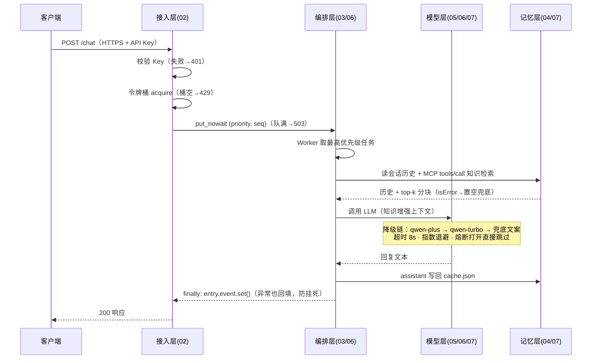
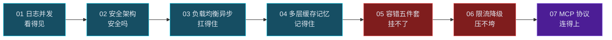

# char12 架构汇总说明 —— 上线部署篇：从单脚本 Agent 到生产化 Web 服务

> **SVG 独立架构图目录**（可直接浏览器打开，暗色主题，建议从 01 开始阅读）：
>
> | 文件 | 视角 |
> |---|---|
> | [svg/01_分层架构总图.svg](svg/01_分层架构总图.svg) | 七层组件栈：客户端 → 接入防御 → Web → 编排 → 容错 → 记忆 → 模型/协议 + 横切关注 |
> | [svg/02_七篇演进线全景图.svg](svg/02_七篇演进线全景图.svg) | 七步进阶路线：看得见 → 安全吗 → 扛得住 → 记得住 → 挂不了 → 压不垮 → 连得上 |
> | [svg/03_请求生命线时序图.svg](svg/03_请求生命线时序图.svg) | 一个请求穿过七道工序的全旅程（含 429/503/504 提前返回点） |
> | [svg/04_不变式规律与教材学费图.svg](svg/04_不变式规律与教材学费图.svg) | 穿透七篇的五条铁律 + 教材五笔学费谱系 |

## 一、本章定位

char01-char11 解决"Agent 怎么建"（编排、工具、记忆、多 Agent、协议），char12 解决"**Agent 怎么上线**"：把前十一章的单脚本能力组装进一个可公网暴露的 Web 服务，并补齐生产化的五块拼图——**可观测、安全、吞吐、容错、开放互联**。

七篇对应关系：

| 篇 | 示例 | 生产化拼图 | 核心组件 |
|---|---|---|---|
| 01 | Web 服务记录日志并发 | 可观测 | Flask threaded + request_id 链路追踪 + /health |
| 02 | 部署环境安全架构手段 | 安全 | HTTPS adhoc + API Key 恒时比较 + flask-limiter + 安全响应头 |
| 03 | API 负载均衡与异步任务调度 | 吞吐 | ThreadPoolExecutor + RoundRobin + 任务状态落盘 |
| 04 | 多层级缓存与记忆系统 | 状态 | JSONCache 会话历史 + 语义向量缓存 + 余弦检索 |
| 05 | 智能体容错机制实现 | 稳定性 | 容错五件套（超时/退避/切换/熔断/降级）+ 故障注入器 |
| 06 | 高并发的限流与降级策略 | 稳定性 | 令牌桶 + PriorityQueue 削峰 + Worker 池 + 三态拒绝语义 |
| 07 | 模拟 MCP 服务与 Coze 调用 | 互联 | MCP 2025-06-18 规范：JSON-RPC 2.0 + initialize + tools/resources |

## 二、分层架构图（Mermaid）

```mermaid
flowchart TD
    CLI[客户端层<br/>curl / 压测线程 / Coze Bot] --> GW

    subgraph GW[接入防御层 02]
        HTTPS[HTTPS adhoc] --> KEY[API Key 恒时比较] --> FL[flask-limiter 429] --> SEC[安全响应头]
    end

    GW --> WEB

    subgraph WEB[Web 服务层 01/06]
        FLASK[Flask threaded] --> TB[令牌桶 TokenBucket<br/>Lock 原子+初始满桶+惰性补充]
    end

    WEB --> ORCH

    subgraph ORCH[编排层 03/06]
        PQ[PriorityQueue<br/>(priority, seq)] --> WKR[Worker 池 ×2<br/>finally 必回填]
    end

    ORCH --> FT

    subgraph FT[容错层 05/06]
        TMO[超时 8s] --> RET[指数退避] --> CB[熔断器<br/>2 连败打开·30s 半开] --> FB[降级兜底]
    end

    FT --> MEM

    subgraph MEM[记忆/知识层 04/07]
        JC[JSONCache 会话历史] --> VEC[向量缓存] --> COS[余弦 top-k 检索]
    end

    MEM --> MDL

    subgraph MDL[模型/协议层 05/06/07]
        DS[dashscope qwen-plus<br/>→ qwen-turbo → 兜底] -.被调用.- MCP[MCP Server<br/>JSON-RPC 2.0·tools/resources]
    end

    CACHE[(cache.json<br/>状态持久化)] -.替代 Redis.- WEB
    CACHE -.读写.- ORCH
    CACHE -.读写.- MEM
    LOG[request_id 日志<br/>/health 指标] -.横切.- WEB
```

## 三、请求生命线（Mermaid）



## 四、七篇演进线（Mermaid）



三阶段理解：**01-04 把服务摆上线**（基础设施），**05-06 让服务打不死**（稳定性），**07 让服务开放互联**（协议生态）。

## 五、跨章节衔接

| 关联章节 | 衔接点 |
|---|---|
| char01-02（Prompt/链） | char12 把"链"暴露为 `/chat` 端点，请求处理模型从函数调用变为 HTTP 生命周期 |
| char03（服务化门面） | 03 章建立"校验 → 记忆 → 工具 → 生成"的服务骨架，char12 逐层加固 |
| char08（状态感知/Memory） | 04 篇 JSONCache 是 char08 Memory 讨论的服务端持久化形态 |
| char10-05（A2A） | A2A 管 agent↔agent 协作；07 篇 MCP 管 agent↔工具/数据——互补协议栈 |
| char07（虚构 MCP 段） | 07 篇给出真实 MCP 答案：JSON-RPC 2.0 + 生命周期 + 三大原语 |

## 六、五条不变式（新人重点背诵）

1. **外部接口必有兜底**——任何网络调用都假设会失败：LLM → 兜底文案，embedding → 检索置空，MCP 工具 → isError。
2. **状态必须落盘**——cache.json 替代 Redis：会话历史、任务状态、令牌余量、语义向量，重启不丢且恢复语义正确。
3. **可观测三件套**——request_id 日志 + 分维度统计 + /health 端点；并发正确性靠数据证明，不靠 print 猜。
4. **故障必须实测触发**——故障注入器 + 并发突发 + 错峰时序构造；只走 happy path 的容错等于没写。
5. **协议与传输解耦**——按真实开放标准实现（MCP 2025-06-18），教学进程内传递，生产换 stdio/HTTP 协议层零改动。

## 七、教材五笔学费（谱系）

| 学费 | 表现 | 偿还方式 |
|---|---|---|
| 虚构类 | Qwen2Chat / DeepSeekChat 不存在 | qwen-plus / qwen-turbo 真实双后端 |
| 废弃 API | ConversationChain、`@app.on_event` | LCEL 思想的直接实现 + Flask 统一 |
| 非原子竞态 | Redis get/decr 三步分离 | threading.Lock 原子化（Redis 场景应 Lua 脚本） |
| 伪协议 | mcp: 键前缀冒充 MCP 协议 | 真实 JSON-RPC 2.0 + 生命周期 + 原语实现 |
| 零验证 | 限流/削峰/容错从未触发 | 每篇 4-6 项 self-test，机制全部实测 |

## 八、新人学习建议

1. **先读 01 和 06**：01 教会你"服务怎么立起来 + 怎么观测"，06 教会你"怎么在高并发下活下来"——两篇合起来是最小生产骨架。
2. **把 05 的故障注入器当作方法论**：之后写任何防御性代码，先问自己"我能不能精确构造它防御的故障并断言行为"。
3. **07 的协议辨析要背**：MCP 三大原语（tools/resources/prompts）、initialize 生命周期、协议错误 vs isError 的区分是 2025 年 Agent 岗位的高频考点。
4. **动手改造练习**：把 06 的令牌桶搬进 02 的 flask-limiter 位置（自研替换框架限流），体会两种限流的取舍。
