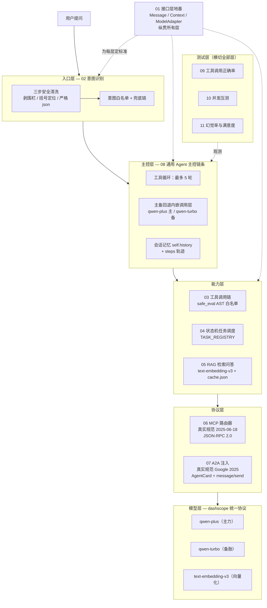
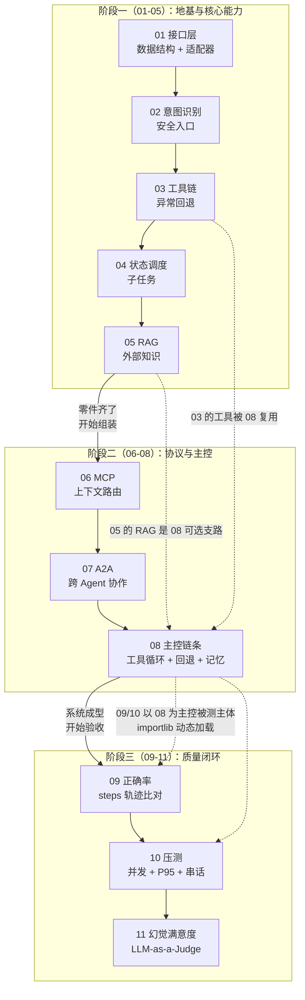
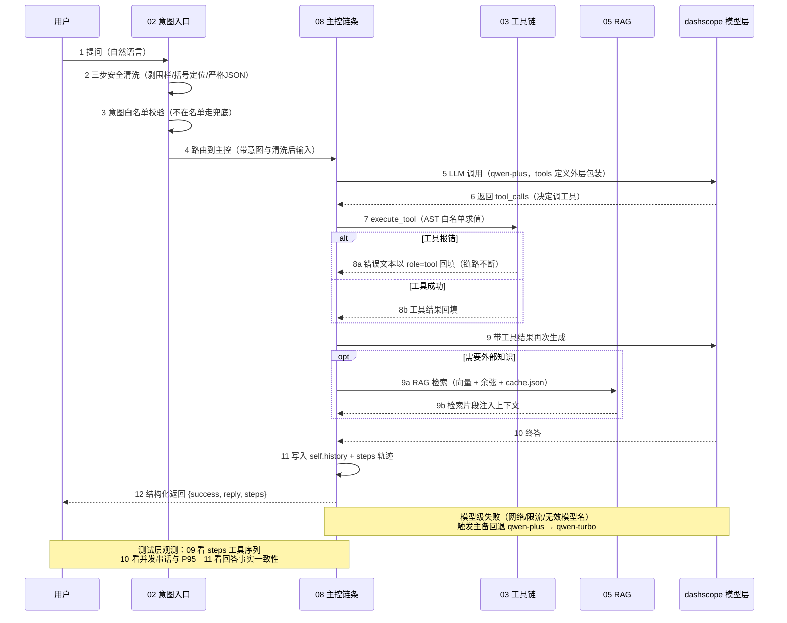
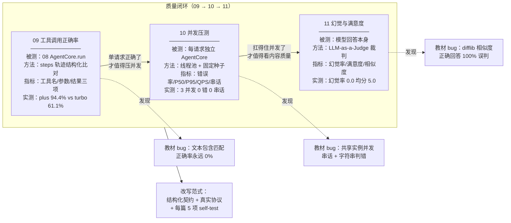

# char13 架构汇总说明：从零实现一个复合智能体系统

> **SVG 架构图速查**（暗色主题手工绘制，可直接浏览器打开）：
> [svg/01_分层总图.svg](svg/01_分层总图.svg) ｜ [svg/02_演进线全景.svg](svg/02_演进线全景.svg) ｜ [svg/03_生命线时序.svg](svg/03_生命线时序.svg) ｜ [svg/04_不变式规律.svg](svg/04_不变式规律.svg)
>
> **配套文档**：[index_汇总说明.html](index_汇总说明.html)（网页版总览，含 SVG 速查卡片）｜ 11 篇逐篇讲解 HTML 见文末资源索引

---

## 一、这一章 11 个 py 文件在表达什么

char13 是全书收官章：**用一个"复合智能体系统"把前 12 章的零件组装成一台完整的机器，再用测试三部曲证明这台机器真的能跑、扛得住、不说谎。**

11 个 py 文件回答五个层层递进的核心问题：

| # | 核心问题 | 承接篇目 | 一句话答案 |
|---|---------|---------|-----------|
| 1 | 智能体的"零件"长什么样？ | 01 | Message / ConversationContext / ModelAdapter——统一数据结构与模型适配器 |
| 2 | 用户的话怎么进来？ | 02 | 意图识别 + 三步安全清洗 + 白名单兜底，LLM 输出永不直接执行 |
| 3 | 模型不够格怎么办？ | 03 / 05 | 工具调用链补足能力，异常回退兜底；RAG 检索外部知识 |
| 4 | 复杂任务怎么拆？怎么跨系统协作？ | 04 / 06 / 07 | 状态机调度子任务；MCP / A2A 真实协议接入外部世界 |
| 5 | 这台机器真的可靠吗？ | 08 / 09 / 10 / 11 | 主控链条串联一切；正确率、并发压测、幻觉满意度三步质量闭环 |

---

## 二、分层架构总图

**读图要点**：
- 01 是纵贯条——所有层共享它定义的 Message / Context 数据结构，这就是"接口层先行"的架构含义；
- 08 主控层是系统的"心脏"，工具循环、主备回退、记忆全部内嵌在**模型调用层**（教材假回退的教训：把回退放在 executor 外面等于没做）；
- 09/10/11 测试层不实现业务，只**观测**主控层行为——测试与实现分离。

---

## 三、演进关联图：11 篇如何一步步长出来

**读图要点**：
- 阶段一**造零件**，阶段二**组装 + 接标准**，阶段三**验收**——依赖箭头说明为什么顺序不能乱：09/10 的测试对象就是 08 的 AgentCore，没有 08 就没有可测主体；
- 虚线是"复用"关系：03 的工具注册表、05 的 RAG 支路都被 08 收编为主控链条的一部分。

---

## 四、一次提问的生命线（请求时序）

**读图要点**：
- 第 8 步的 alt 分支是**双层失败语义**的关键：工具级失败是"数据"，回填给模型让它自己调整；只有模型级失败才走主备回退——教材把两者混为一谈是经典错误；
- 第 5 步的"tools 定义外层包装"对应实测教训：dashscope 原生 API 传 OpenAI 风格裸列表会被**静默忽略**（无报错但模型看不到工具）；
- 12 步返回结构化契约而非纯文本——09/10/11 全部依赖 steps 轨迹与 success 布尔值。

---

## 五、质量闭环：测试三部曲如何互相咬合

**读图要点**：
- 三步有严格递进逻辑：**对 → 扛得住 → 不说谎**，顺序反了会浪费测试成本；
- 每一步都顺手实证了教材对应的设计缺陷（虚线指向的三条 bug 均有实测数据支撑，详见各篇 HTML 第五节）。

---

## 六、11 篇清单角色地图

| 篇目 | 角色 | 层次 | 关键产出 | 自测 |
|------|------|------|---------|------|
| [01 先定义标准的Agent接口层和数据结构](01_先定义标准的Agent接口层和数据结构.html) | 地基 | 接口层 | Message 构造校验 / ConversationContext / ModelAdapter 注册表 + 池化 | 5/5 |
| [02 用户意图识别与入口解析](02_用户意图识别与入口解析.html) | 守门 | 入口层 | 三步安全清洗 / 意图白名单 / 兜底链 | 5/5 |
| [03 工具调用链与异常回退机制](03_工具调用链与异常回退机制.html) | 手脚 | 能力层 | safe_eval AST 白名单 / 双层失败语义 / 主备回退 | 5/5 |
| [04 子状态管理与任务调度](04_子状态管理与任务调度.html) | 调度 | 能力层 | 状态机白名单 / TASK_REGISTRY | 5/5 |
| [05 RAG检索问答子系统](05_RAG检索问答子系统.html) | 知识 | 能力层 | text-embedding-v3 / cache.json 缓存 / 余弦检索 | 5/5 |
| [06 MCP协议的上下文路由器](06_MCP协议的上下文路由器.html) | 协议 | 协议层 | 真实 MCP 2025-06-18 规范：JSON-RPC 2.0 + initialize + tools 原语 | 5/5 |
| [07 A2A消息协议的模块注入](07_A2A消息协议的模块注入.html) | 协议 | 协议层 | 真实 A2A Google 2025：AgentCard + message/send + Task 生命周期 | 5/5 |
| [08 LangChain的通用Agent主控链条](08_LangChain的通用Agent主控链条.html) | 心脏 | 主控层 | 工具循环 ≤5 轮 / 回退内嵌调用层 / 记忆 + steps 轨迹 | 5/5 |
| [09 Test工具调用正确率测试框架](09_Test工具调用正确率测试框架.html) | 验收① | 测试层 | steps 结构化比对（修复教材文本匹配死逻辑） | 5/5 |
| [10 Test多用户并发测试与系统压测](10_Test多用户并发测试与系统压测.html) | 验收② | 测试层 | 每请求独立实例 / 串话检测 / P95 线性插值 / 可复现种子 | 5/5 |
| [11 Test模型幻觉率与用户满意度评估](11_Test模型幻觉率与用户满意度评估.html) | 验收③ | 测试层 | LLM-as-a-Judge 裁判 / 三步清洗复用 / None≠False 口径 | 5/5 |

---

## 七、贯穿全章的六条不变式

无论看哪一篇，以下设计决策在 11 个文件中**全部一致**——这是本章真正的"架构"：

1. **dashscope 统一协议**：所有 LLM 调用走 `dashscope.Generation.call(model=..., result_format="message")`；tools 参数必须 `{"type":"function","function":{...}}` 外层包装（裸列表被静默忽略——13-08 实测教训）。
2. **LLM 输出永不执行**：02 三步清洗（剥围栏→括号定位→严格 json.loads）、03 AST 白名单求值、11 裁判输出同样清洗——eval 在全章零出现。
3. **错误与状态都是数据**：工具错误以 role=tool 回填而非炸链路；success 用布尔而非 `"[ERROR]"` 字符串；裁判失败（None）与判不一致（False）分开统计。
4. **注册表消灭 if/elif**：MODEL_REGISTRY / TASK_REGISTRY / TOOL_REGISTRY / 意图白名单 / 工具注册表——五张表驱动全部分发逻辑。
5. **可观测性内建**：08 的 steps 轨迹、10 的 tool_hits 与串话检测、11 的 judge_failures——不靠 print 混流，靠结构化字段。
6. **self-test 分层**：每篇恰好 5 项——纯函数单测 → 边界 → 真实调用 → 契约校验，非确定行为（是否调工具）分路径验契约。

---

## 八、教材通病与改写范式

11 篇原代码呈现高度一致的七类问题，改写也形成固定范式：

| 教材通病 | 典型篇目 | 改写范式 |
|---------|---------|---------|
| 虚构依赖（Qwen2Chat / DeepSeekChat / qwen-agent） | 01/08/09/10/11 | 保留原代码注释 + dashscope 原生实现 |
| 过时协议简化模拟（MCP / A2A） | 06/07 | 按真实 2025 规范重写，文档辨析差异 |
| LLM 输出直接 eval | 02/03 | 三步清洗 / AST 白名单 |
| 假回退（回退在 executor 外） | 08 | 回退内嵌模型调用层 |
| 字符串判错（"[ERROR]" in output） | 10/11 | 布尔 success + 结构化契约 |
| 共享可变状态（并发串话） | 10 | 每请求独立实例 |
| 冒充检测（difflib 相似度）/ 造假数据（随机满意度） | 11 | LLM-as-a-Judge + 内容相关评分（标注为代理评估） |

---

## 九、新人学习路径（建议三周）

**第 1 周——顺着读（建立全景）**：按 01 → 02 → 03 → 04 → 05 顺序读代码 + 对应 HTML，重点理解 01 的接口如何被后续每层复用；读完对照 [svg/01_分层总图.svg](svg/01_分层总图.svg) 自查能否默画分层。

**第 2 周——横着比（理解设计决策）**：精读 08 主控链条，回看 03 理解"双层失败语义"为什么必须内嵌调用层；再读 06/07 对照文档辨析教材简化协议与真实规范差异；读完对照 [svg/03_生命线时序.svg](svg/03_生命线时序.svg) 走一遍 13 步请求流程。

**第 3 周——动手测（验收思维）**：读 09/10/11，理解三步递进逻辑（对 → 扛得住 → 不说谎）；运行 10 的压测并改 RANDOM_SEED 观察结果稳定性；读完对照 [svg/04_不变式规律.svg](svg/04_不变式规律.svg) 检查能否举出每条不变式在具体篇目的落点。

**运行环境**：虚拟环境 `d:/MyCode/.venv/Scripts/python.exe`，需配置环境变量 `DASHSCOPE_API_KEY`；每篇直接 `python XX_标题.py` 即可执行（内含 self-test）。

---

## 十、资源索引

- **网页版总览**：[index_汇总说明.html](index_汇总说明.html)（含 SVG 速查卡片、五核心问题、学习路径）
- **SVG 架构图**（暗色主题，浏览器直接打开）：[01_分层总图](svg/01_分层总图.svg) ｜ [02_演进线全景](svg/02_演进线全景.svg) ｜ [03_生命线时序](svg/03_生命线时序.svg) ｜ [04_不变式规律](svg/04_不变式规律.svg)
- **逐篇讲解 HTML**：见第六节表格链接列，每篇含"背景与目的 / 原代码问题剖析 / 改写设计 / 核心组件详解 / 实测验证 / 前后衔接"九节结构
- **源代码**：本目录 11 个 py 文件，头部注释完整保留教材原代码（以 `#` 注释形式）并标注问题清单
